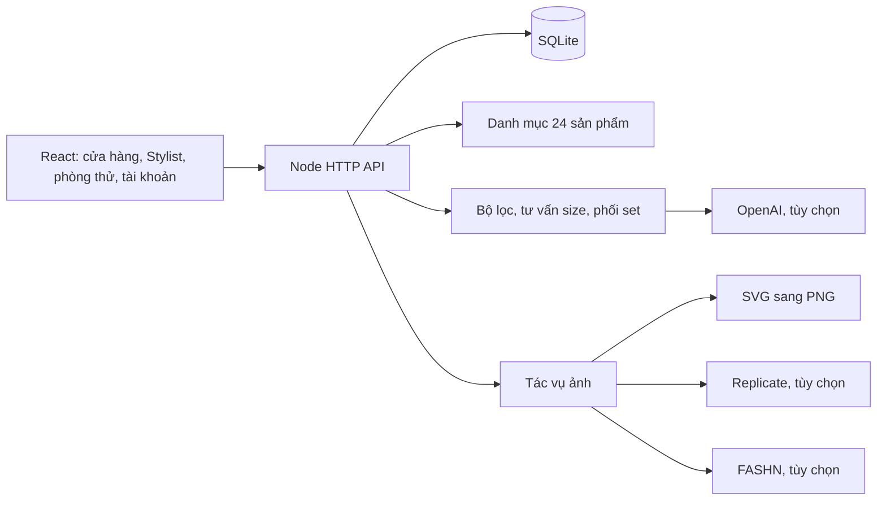

# Bàn giao bản demo FORME Studio

## Luồng dữ liệu

- Tài khoản, phiên, media, tác vụ và quota nằm trong các bảng riêng. Hồ sơ, giỏ và hội thoại được lưu dưới chủ sở hữu phiên hoặc tài khoản. Mặc định DB ở `.runtime/forme.sqlite`.
- Cookie giữ mã phiên ngẫu nhiên, chỉ backend đọc được; SQLite lưu bản băm của mã. Phiên khách tồn tại 7 ngày. Khi khách đăng nhập, giỏ được gộp đến giới hạn tồn kho và hội thoại được nối theo thời gian; hồ sơ hiện có của tài khoản được ưu tiên. Lượt thử khách đã lưu, không có ảnh chân dung, được chuyển sang tài khoản. Ảnh nguồn của phiên khách không được chuyển.
- Mannequin nhận năm số đo và sáu tông da. Chiều cao thay đổi phần thân và chân quanh điểm nối cổ; ngực, eo và hông thay đổi độ rộng; đầu giữ kích thước. Phôi PNG có nền `#F3F4F6`. Ảnh minh họa dùng dáng và màu gần với thiết kế mẫu; không mô phỏng độ vừa, chất vải hoặc độ rủ thực tế.
- Tác vụ chạy bất đồng bộ trong một tiến trình. Cache gắn với chủ sở hữu, phiên bản hồ sơ, ảnh nguồn, sản phẩm và chế độ xử lý. Tác vụ gián đoạn khi khởi động lại báo lỗi và có thể thử lại. Quota ngày áp dụng cho tổng lượt ảnh gửi ra ngoài. Các tác vụ AI không tự gửi lại yêu cầu tạo ảnh sau lỗi.
- Ảnh tải lên, phôi và kết quả chưa lưu hết hạn sau 24 giờ. Lượt thử đã lưu của tài khoản được giữ 30 ngày. Xóa ảnh chân dung thu hồi ảnh và tác vụ phụ thuộc; việc xóa chỉ áp dụng cho bản lưu trong ứng dụng. Lịch sử tải qua route kiểm tra chủ sở hữu giống ảnh và tác vụ.

## API

| Nghiệp vụ | Route |
| --- | --- |
| Phiên | `GET /api/session`; `POST /api/auth/register`, `/login`, `/logout` |
| Danh mục | `GET /api/products`, `GET /api/products/:id` |
| Hồ sơ | `GET`, `PUT /api/profile` |
| Giỏ | `GET /api/cart`; `POST`, `PATCH`, `DELETE /api/cart/items` với `productId`, `size`, `quantity` |
| Stylist | `GET /api/recommendations`; `POST /api/search`, `POST /api/chat`; `GET /api/conversations/:id` |
| Ảnh | `POST /api/media` với data URI PNG/JPEG/WebP; `GET`, `DELETE /api/media/:id` |
| Thử đồ | `POST /api/avatars`, `POST /api/try-ons` với `profileVersion`; `GET /api/jobs/:id`; `GET /api/try-ons`; `PATCH /api/try-ons/:id` để lưu |
| Quản trị demo | `GET /api/admin/overview` |

API lỗi trả `{ code, message, requestId }`. Tác vụ có các trạng thái `queued`, `processing`, `completed`, `failed`; `stage` cho UI biết bước hiện tại. Tác vụ trả ảnh qua URL cùng origin, không trả khóa API hay URL kết quả riêng tư của nhà cung cấp.

## Kiểm thử và giới hạn đã biết

| Hạng mục | Kết quả |
| --- | --- |
| Tư vấn, tìm kiếm | Đã kiểm thử 15 tình huống bằng bộ quy tắc, gồm lọc cứng theo giá, tông, loại, dịp, tồn kho, size, phối set và kết quả rỗng. |
| Phiên, phân quyền, giỏ, lịch sử | Đã kiểm thử API với hai phiên độc lập, ảnh sai định dạng, thao tác xóa, gộp dữ liệu khi đăng ký và khôi phục giỏ khi đăng nhập lại. |
| Luồng trên trình duyệt | Đã chạy với viewport desktop 1440 px, tablet 768 px và điện thoại 390 px. Kiểm tra tải ảnh, tìm kiếm, chat, điều hướng thử đồ, kích thước PNG tải về, giỏ và lịch sử. |
| LLM | Có adapter [OpenAI Chat Completions](https://platform.openai.com/docs/api-reference/chat/create). Chưa kiểm tra phản hồi trực tiếp vì chưa có khóa. |
| Face Swap | Có adapter [Replicate Face Swap](https://replicate.com/codeplugtech/face-swap/api). Chưa chạy với ảnh chân dung thật và phôi SVG; mặc định tắt. |
| Virtual Try-On | Có adapter [FASHN Try-On v1.6](https://docs.fashn.ai/api-reference/tryon-v1-6). Chưa có kết quả thật cho áo, quần/váy hay đầm. Để trống `TRYON_AI_CATEGORIES` cho tới khi xác nhận từng nhóm. |

Điểm nghiệm thu thử ảnh thật trong `Tasks.md` cần khóa API và ảnh được phép sử dụng. Sau khi cấu hình, thử trước một áo với phôi 2D, ghi thời gian và lỗi nhận diện; nếu dùng ảnh người mẫu đối chứng, ghi rõ đầu vào đối chứng. Sau đó kiểm tra ít nhất 10 cặp và chỉ bật nhóm đạt. Không có thanh toán, vận chuyển hoặc quản trị đơn hàng trong MVP. Slide, video và bảng giờ làm việc của nhóm là phần hồ sơ dự án riêng.
