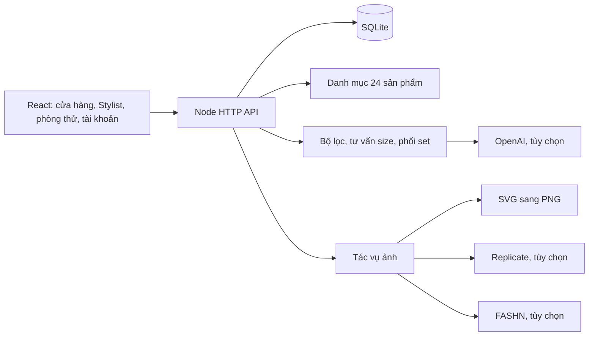

# Bàn giao bản demo FORME Studio

## Luồng dữ liệu

- Tài khoản, phiên, media, tác vụ và quota nằm trong các bảng riêng. Hồ sơ, giỏ và hội thoại được lưu dưới chủ sở hữu phiên hoặc tài khoản. Mặc định DB ở `.runtime/forme.sqlite`.
- Cookie giữ mã phiên ngẫu nhiên, chỉ backend đọc được; SQLite lưu bản băm của mã. Phiên khách tồn tại 7 ngày. Khi khách đăng nhập, giỏ được gộp đến giới hạn tồn kho và hội thoại được nối theo thời gian; hồ sơ hiện có của tài khoản được ưu tiên. Lượt thử khách đã lưu, không có ảnh chân dung, được chuyển sang tài khoản. Ảnh nguồn của phiên khách không được chuyển.
- Mannequin nhận năm số đo và sáu tông da. Chiều cao thay đổi phần thân và chân quanh điểm nối cổ; ngực, eo và hông thay đổi độ rộng; đầu giữ kích thước. Phôi PNG có nền `#F3F4F6`. Ảnh minh họa dùng dáng và màu gần với thiết kế mẫu; không mô phỏng độ vừa, chất vải hoặc độ rủ thực tế.
- Tác vụ chạy bất đồng bộ trong một tiến trình. Cache gắn với chủ sở hữu, phiên bản hồ sơ, ảnh nguồn, sản phẩm và chế độ xử lý. Tác vụ gián đoạn khi khởi động lại báo lỗi và có thể thử lại. Quota ngày áp dụng cho tổng lượt ảnh gửi ra ngoài. Các tác vụ AI không tự gửi lại yêu cầu tạo ảnh sau lỗi.
- Ảnh tải lên, phôi và kết quả chưa lưu hết hạn sau 24 giờ. Lượt thử đã lưu của tài khoản được giữ 30 ngày. Xóa ảnh chân dung thu hồi ảnh và tác vụ phụ thuộc; việc xóa chỉ áp dụng cho bản lưu trong ứng dụng. Lịch sử tải qua route kiểm tra chủ sở hữu giống ảnh và tác vụ.

## API

| Nghiệp vụ | Route |
| --- | --- |
| Phiên | `GET /api/session`; `POST /api/auth/register`, `/login`, `/logout` |
| Danh mục | `GET /api/products`, `GET /api/products/:id` |
| Hồ sơ | `GET`, `PUT /api/profile` |
| Giỏ | `GET /api/cart`; `POST`, `PATCH`, `DELETE /api/cart/items` với `productId`, `size`, `quantity` |
| Stylist | `GET /api/recommendations`; `POST /api/search`, `POST /api/chat`; `GET /api/conversations/:id` |
| Ảnh | `POST /api/media` với data URI PNG/JPEG/WebP; `GET`, `DELETE /api/media/:id` |
| Thử đồ | `POST /api/avatars`, `POST /api/try-ons` với `profileVersion`; `GET /api/jobs/:id`; `GET /api/try-ons`; `PATCH /api/try-ons/:id` để lưu |
| Quản trị demo | `GET /api/admin/overview` |

API lỗi trả `{ code, message, requestId }`. Tác vụ có các trạng thái `queued`, `processing`, `completed`, `failed`; `stage` cho UI biết bước hiện tại. Tác vụ trả ảnh qua URL cùng origin, không trả khóa API hay URL kết quả riêng tư của nhà cung cấp.

## Kiểm thử và giới hạn đã biết

| Hạng mục | Kết quả |
| --- | --- |
| Tư vấn, tìm kiếm | Đã kiểm thử 15 tình huống bằng bộ quy tắc, gồm lọc cứng theo giá, tông, loại, dịp, tồn kho, size, phối set và kết quả rỗng. |
| Phiên, phân quyền, giỏ, lịch sử | Đã kiểm thử API với hai phiên độc lập, ảnh sai định dạng, thao tác xóa, gộp dữ liệu khi đăng ký và khôi phục giỏ khi đăng nhập lại. |
| Luồng trên trình duyệt | Đã chạy với viewport desktop 1440 px, tablet 768 px và điện thoại 390 px. Kiểm tra tải ảnh, tìm kiếm, chat, điều hướng thử đồ, kích thước PNG tải về, giỏ và lịch sử. |
| LLM | Đã tích hợp Google Gemini (`GEMINI_API_KEY`) và OpenAI Chat Completions (`OPENAI_API_KEY`) kèm cơ chế tự động fallback về bộ quy tắc `rules.mjs`. |
| AI Vision Bước 1 (Pose & Matting) | Đã tích hợp `YOLOv8-Pose` (17 keypoints) + `Rembg (u2net_human_seg)` tách nền trắng `#FFFFFF`, lọc vật thể thừa và làm mịn ánh sáng studio (`Bilateral Studio Filter`). |
| AI Vision Bước 2 (Virtual Try-On) | Hỗ trợ song song Phương pháp 1 (`FastAPI Local / LoRA / Pose-Face-Guided`) và Phương pháp 2 (`Google Gemini Multimodal API`) kèm Cache Hash SHA-256. |

---

## Đảm bảo Thiết kế API (API Design Assurance) & Đặc tả Use Cases (Dùng cho Slide Báo cáo)

 Toàn bộ nội dung chi tiết phục vụ Slide thuyết trình về **Đảm bảo Thiết kế API (8 trụ cột chất lượng SOA/REST)** và **Đặc tả Use Cases (Actors, Sơ đồ Use Case, Bảng Pre/Post-conditions, Luồng chính/Ngoại lệ và 2 Sequence Diagrams)** đã được biên soạn đầy đủ tại:
- `docs/Tasks_SOA.md` — **Mục 4.2: Cơ chế Đảm bảo Thiết kế API (API Design Assurance & SOA Quality Attributes)**
- `docs/Tasks_SOA.md` — **Phần 5: Đặc tả Use Cases & Biểu đồ Tuần tự (Sequence Diagrams cho Slide)**

### Tóm tắt nhanh 8 cơ chế Đảm bảo Thiết kế API cho Slide:
1. **Contract-First & OpenAPI 3.0 Federation:** 5 tệp đặc tả JSON độc lập (`docs/api/01..05.json`) dùng chung `common-schemas.json`, hợp nhất tự động tại `GET /api/openapi.json`.
2. **Service Autonomy & Loose Coupling:** 5 Router dịch vụ SOA tách biệt, giao tiếp với AI Microservice (`FastAPI :5001`) và Cloud AI qua REST JSON phi trạng thái.
3. **RESTful Resource & Semantic HTTP Codes:** Chuẩn hóa danh từ tài nguyên và mã phản hồi (`200`, `201`, `202 Accepted`, `400`, `401`, `403`, `404`, `409 Conflict`, `413`, `415`, `422`, `429`, `500`).
4. **Unified Error Envelope & Request Tracing:** Mọi lỗi đều có dạng `{ code, message, requestId }` với `requestId` (UUID v4) để truy vết log.
5. **Optimistic Concurrency & Async Job Polling:** Kiểm soát `profileVersion` (`409 STALE_PROFILE`), khóa `chatBusy` (`409 CHAT_BUSY`) và cơ chế `202 Accepted` + polling `GET /api/jobs/:id`.
6. **Content-Addressed Caching (SHA-256):** Băm tổ hợp `(method, framing, personImageHash, sortedItems)` giúp trả kết quả phối đồ trùng lặp dưới `50ms` (`cached: true`).
7. **Defense-in-Depth Security:** Cookie `HttpOnly; SameSite=Lax`, token băm `SHA-256`, mật khẩu `scrypt`, kiểm tra `Origin` chống CSRF, giới hạn payload và Rate Limiting theo IP/Owner.
8. **3-Tier Graceful Fallback & Privacy TTL 24h:** Tự động chuyển đổi mượt giữa `Gemini API` ➔ `FastAPI AI Microservice` ➔ `Gateway Sharp 2D`; tiến trình `store.sweep()` tự động xóa ảnh tạm của khách sau 24 giờ.
