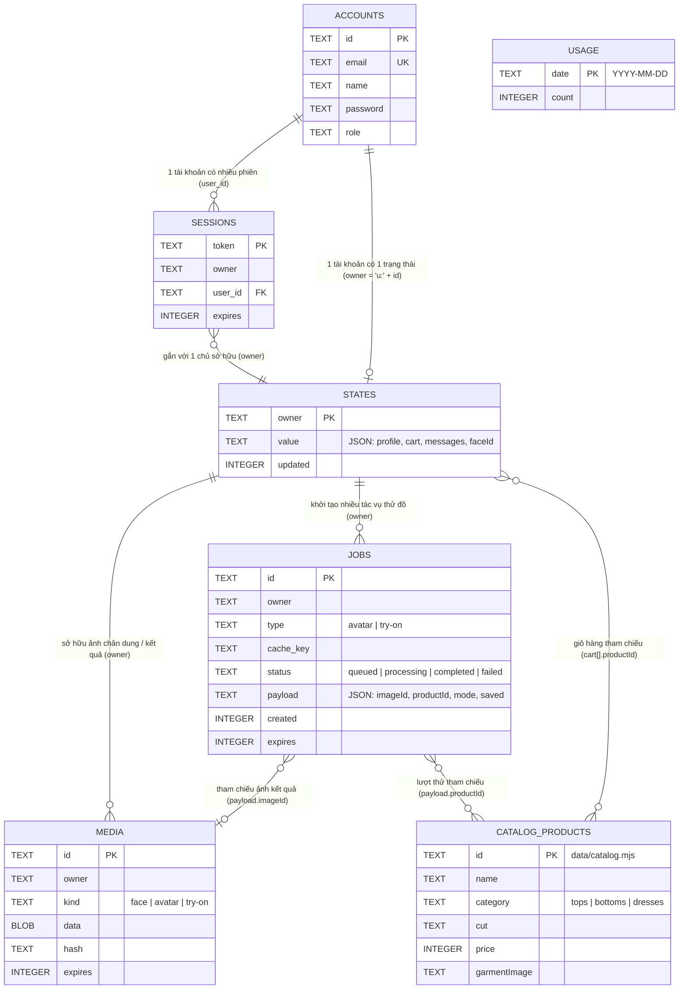
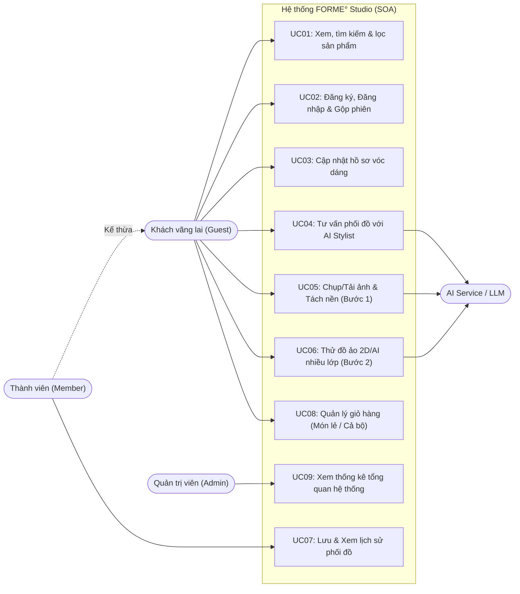
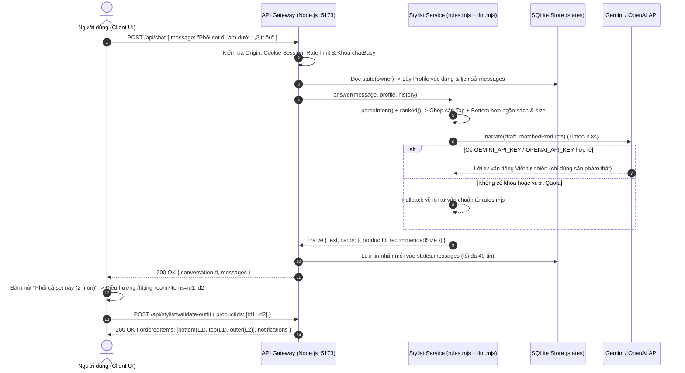
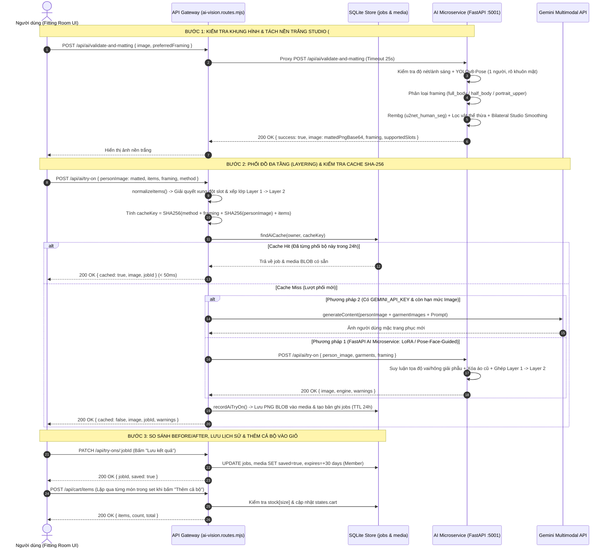

# TÀI LIỆU THIẾT KẾ KIẾN TRÚC VÀ KẾ HOẠCH PHÂN CÔNG API (SOA & AI)

**Đề tài:** Hệ thống thương mại điện tử thời trang tích hợp AI Stylist và AI Phối đồ thực tế (Virtual Try-On 2 bước)  
**Kiến trúc:** Service-Oriented Architecture (SOA) kết hợp AI Microservice (`ai-service/app.py`)  
**Chuẩn đặc tả API:** OpenAPI 3.0 định dạng JSON (`docs/api/*.json`)  
**Quy mô phân công phần API:** 5 thành viên (chia đều 20% khối lượng / người)

---

## 📌 NGUYÊN TẮC THIẾT KẾ VÀ PHẠM VI DỰ ÁN

1. **Phần Giao diện Bán hàng (Shop UI) — GIỮ NGUYÊN**:
   * Tận dụng toàn bộ giao diện bán hàng demo đã xây dựng sẵn (`frontend/src/features/shop/Shop.jsx`, `Account.jsx`, bộ CSS và Navbar/Footer).
   * Thành viên **Nguyễn Xuân Tường** chịu trách nhiệm duy trì UI hiện có, chỉ tập trung đấu nối dữ liệu API thực, tích hợp Widget Chatbot và kích hoạt nút *"Thử ngay"* / *"Phối cả set"* để điều hướng sang Phòng phối đồ.
2. **Các Phân hệ còn lại — THIẾT KẾ CƠ BẢN ĐỂ THÀNH VIÊN TỰ TAY THỰC HIỆN**:
   * Tài liệu này đóng vai trò là **Bản Đặc tả Kỹ thuật và Khung Thiết kế Nền tảng (Baseline Architectural Blueprint)**.
   * Cung cấp đầy đủ: Kiến trúc thành phần, Lược đồ Database (Schema), Hợp đồng API (Contracts), Thuật toán cốt lõi, Kịch bản huấn luyện AI LoRA và Mô hình máy trạng thái (State Machine).
   * Trên cơ sở đó, từng thành viên (**Lợi, Thành, Tùng, Trí**) sẽ tự tay thiết kế chi tiết mã nguồn, thuật toán và triển khai từ đầu (from scratch) cho phân hệ của mình.
3. **Chi phí bên thứ ba = 0 VNĐ**:
   * Tuyệt đối không dùng API trả phí (FASHN.ai).
   * Toàn bộ mô hình AI sử dụng mã nguồn mở SOTA (YOLOv8-pose, BiRefNet/RMBG-1.4, CatVTON) và **tự huấn luyện LoRA trên máy tính có GPU NVIDIA của thành viên An Đức Minh Trí**.

---

## MỤC LỤC

- **PHẦN 1. BẢN THIẾT KẾ KIẾN TRÚC NỀN TẢNG (BASELINE SYSTEM DESIGN)**
  - 1.1. Sơ đồ Kiến trúc Tổng thể (SOA System Blueprint)
  - 1.2. Thiết kế Cơ bản: Giao diện Phòng phối đồ AI & Camera Guide
  - 1.3. Thiết kế Cơ bản: Backend Gateway, Database & Quản lý Phiên
  - 1.4. Thiết kế Cơ bản: AI Stylist & Thuật toán Phân tầng Layering
  - 1.5. Thiết kế Cơ bản: AI Vision Pipeline 2 Bước & Huấn luyện LoRA
  - 1.6. Chuẩn hóa Hợp đồng API Dùng chung (OpenAPI 3.0 JSON Specifications)
- **PHẦN 2. KẾ HOẠCH PHÂN CÔNG NHIỆM VỤ API CHO 5 THÀNH VIÊN**
  - 2.1. Cấu trúc thư mục đặc tả JSON (`docs/api/`) và Phân định sở hữu
  - 2.2. Chi tiết đầu việc API từng thành viên (Lợi, Tường, Tùng, Thành, Trí)
  - 2.3. Quy chuẩn chung (API Governance) và Đầu việc nhóm
  - 2.4. Tổng hợp phân bổ khối lượng (Cân bằng 20% / thành viên)
- **PHẦN 3. TIẾN ĐỘ, KIỂM THỬ VÀ NGHIỆM THU HỌC THUẬT**
  - 3.1. Kế hoạch phân chia nhiệm vụ theo từng tuần (2 tuần: 30/11/2026 – 13/12/2026) và Ma trận bàn giao
  - 3.2. 10 Kịch bản kiểm thử tích hợp End-to-End (K01 – K10)
  - 3.3. Hồ sơ học thuật phục vụ báo cáo (Loss Curve, SSIM, CLIP Score)
  - 3.4. Phân chia thuyết trình và kịch bản demo
- **PHẦN 4. TỔNG HỢP ENDPOINT, ĐẢM BẢO THIẾT KẾ API, MÔ HÌNH DỮ LIỆU & ERD**
  - 4.1. Danh sách đầy đủ Endpoint của ứng dụng (5 Dịch vụ SOA + AI Microservice)
  - 4.2. Cơ chế Đảm bảo Thiết kế API (API Design Assurance & SOA Quality Attributes)
  - 4.3. Mô hình Dữ liệu (Data Models)
  - 4.4. Mô hình Quan hệ Thực thể (ERD)
- **PHẦN 5. ĐẶC TẢ USE CASES & BIỂU ĐỒ TUẦN TỰ (SEQUENCE DIAGRAMS CHO SLIDE)**
  - 5.1. Các tác nhân (Actors)
  - 5.2. Sơ đồ Use Case Tổng quan
  - 5.3. Bảng đặc tả chi tiết 9 Use Case chính (Pre/Post-conditions, Main & Alternative Flows)
  - 5.4. Biểu đồ Tuần tự (Sequence Diagrams) cho các Use Case cốt lõi
  - 5.5. Gợi ý bố cục Slide thuyết trình (Đảm bảo Thiết kế API & Use Cases)

---

# PHẦN 1. BẢN THIẾT KẾ KIẾN TRÚC NỀN TẢNG (BASELINE SYSTEM DESIGN)

### 1.1. Sơ đồ Kiến trúc Tổng thể (SOA System Blueprint)

```text
┌────────────────────────────────────────────────────────────────────────┐
│                        TẦNG TRÌNH DIỄN (FRONTEND)                     │
│  ┌───────────────────────────────┐   ┌──────────────────────────────┐  │
│  │     Shop & Chatbot UI         │   │  Fitting Room & Camera Guide │  │
│  │     (GIỮ NGUYÊN UI CŨ)        │   │    (THIẾT KẾ MỚI TỪ ĐẦU)     │  │
│  │  Nguyễn Xuân Tường phụ trách  │   │  Nguyễn Phúc Thành phụ trách │  │
│  └──────────────┬────────────────┘   └──────────────┬───────────────┘  │
└─────────────────┼───────────────────────────────────┼──────────────────┘
                  │ HTTP / REST API                   │
                  ▼                                   ▼
┌────────────────────────────────────────────────────────────────────────┐
│                  TẦNG TRUNG TÂM & NỀN TẢNG (BACKEND API GATEWAY)        │
│                    (Doãn Duy Lợi thiết kế & phát triển)                │
│  - Session Manager & Guest Identity (Cookie HttpOnly)                  │
│  - Catalog, Cart & Order Services (SQLite / PostgreSQL)                │
│  - Privacy Manager: Cron Job tự động xóa ảnh sau 24h (TTL 24h)         │
│  - Asynchronous Task Dispatcher & In-memory Result Cache               │
│  - Reverse Proxy kết nối tới AI Microservice trên PC của Trí           │
└─────────────────┬───────────────────────────────────┬──────────────────┘
                  │                                   │
         Internal │ REST                     Internal │ REST (LAN / Tunnel)
                  ▼                                   ▼
┌──────────────────────────────────┐ ┌───────────────────────────────────┐
│     AI STYLIST MICROSERVICE      │ │    AI VISION TRY-ON MICROSERVICE  │
│  (Hoàng Lâm Tùng tự phát triển)  │ │   (An Đức Minh Trí tự phát triển) │
│ - Chatbot LLM tư vấn phong cách  │ │     [Chạy trên GPU PC của Trí]    │
│ - Chuẩn hóa Dataset 24 đồ shop   │ │ - Endpoint 1: YOLO + BiRefNet     │
│ - Thuật toán giải quyết xung đột │ │   (Validate & Tách nền trắng)     │
│   slot và sắp xếp Layer 1 / 2    │ │ - Endpoint 2: CatVTON + LoRA      │
│ - Đề xuất phối đồ theo dịp       │ │   (Inference với weights đã train)│
└──────────────────────────────────┘ └───────────────────────────────────┘
```

---

### 1.2. Thiết kế Cơ bản: Giao diện Phòng phối đồ AI & Camera Guide (Nguyễn Phúc Thành)

Thành viên **Nguyễn Phúc Thành** tự tay thiết kế và lập trình giao diện Phòng thử đồ từ đầu tại thư mục `frontend/src/features/fitting-room/`.

#### 1. Cấu trúc Layout 3 Cột (3-Column Layout)
* **Cột 1: Ảnh Người Dùng, Camera Guide & Bước 1 (`fit-profile`)**:
  * Hỗ trợ 3 chế độ khung hình có khuôn mặt: `Toàn thân (full_body)`, `Nửa người (half_body)`, `Cận mặt & vai (portrait_upper)` hoặc `Tự động (auto)`.
  * Tích hợp **Camera Silhouette Guide**, đo ánh sáng realtime và hẹn giờ đếm ngược `3s / 5s` để người dùng kịp đứng vào khung hình.
  * Nút bấm *"Bước 1: Kiểm tra & Tách nền"* chuẩn hóa ảnh về nền trắng thuần `#FFFFFF` (`768×1024`).
* **Cột 2: Khung hình Trung tâm & Trình diễn (`fit-stage`)**:
  * Bộ công cụ so sánh **Before / After** (`Trước (Gốc)`, `Sau (Thử đồ)`, và thanh kéo `So sánh` dùng `clip-path` chồng khít 100%).
  * Các nút chức năng: *"Lưu kết quả"*, *"Lịch sử phối đồ đã lưu"*, *"Tải ảnh kết quả"* và *"Thêm cả bộ vào giỏ"*.
* **Cột 3: Tủ đồ & Quản lý Slot / Phối lớp (`fit-wardrobe`)**:
  * Hiển thị 4 ô slot trực quan kèm chọn size: `Áo trong (top)`, `Khoác ngoài (outer)`, `Quần / Váy (bottom)`, `Đầm liền (dress)`.
  * Danh sách 24 sản phẩm từ `data/catalog.mjs`; khi chọn trùng slot hoặc chuyển đổi giữa Đầm và Áo/Quần sẽ tự động giải quyết xung đột và báo hiệu rõ ràng.
  * Nút bấm *"Bước 2: Bắt đầu phối đồ AI"*.

#### 2. Máy trạng thái giao diện (State Machine Diagram)
```text
[Khởi tạo: Chưa có ảnh]
         │ (Bấm "Tải ảnh" hoặc "Bật Camera + Hẹn giờ 3s/5s")
         ▼
[Chụp/Chọn ảnh] ──► [Chọn khung hình: Tự động / Toàn thân / Nửa người / Cận vai]
                            │
                            ▼ (Bấm "Bước 1: Kiểm tra & Tách nền")
                 [Gửi sang Backend: Bước 1]
                            │
            ┌───────────────┴───────────────┐
            ▼ (Thành công: 1 người + rõ mặt) ▼ (Lỗi: Thiếu mặt/nhiều người/mờ/tối)
   [Hiển thị ảnh nền trắng #FFFFFF] [Hiển thị thông báo lỗi tiếng Việt]
            │                              └──► (Yêu cầu chụp/chọn lại)
            ▼ (Chọn đồ theo Slot & Bấm "Bước 2: Bắt đầu phối đồ AI")
   [Gửi sang Backend: Bước 2 (Kèm kiểm tra Cache Hash)]
            │
            ▼ (Hoàn tất)
   [Hiển thị kết quả Before/After] ──► [Lưu lịch sử / Thêm cả bộ vào giỏ / Tải về]
```

---

### 1.3. Thiết kế Cơ bản: Backend Gateway, Database & Quản lý Phiên (Doãn Duy Lợi)

Thành viên **Doãn Duy Lợi** tự tay thiết kế kiến trúc Backend Gateway tại `backend/src/`.

#### 1. Lược đồ Cơ sở Dữ liệu SQLite (`backend/src/platform/store.mjs`)
```sql
PRAGMA journal_mode = WAL;

-- 1. Bảng Tài khoản Người dùng & Quản trị
CREATE TABLE IF NOT EXISTS accounts (
    id TEXT PRIMARY KEY,
    email TEXT NOT NULL UNIQUE,
    name TEXT NOT NULL,
    password TEXT NOT NULL,            -- scrypt salt:hash
    role TEXT NOT NULL                 -- 'member' | 'admin'
);

-- 2. Bảng Phiên (Guest g:<uuid> & Member u:<userId>)
CREATE TABLE IF NOT EXISTS sessions (
    token TEXT PRIMARY KEY,            -- SHA-256 hash của cookie forme_sid
    owner TEXT NOT NULL,
    user_id TEXT,
    expires INTEGER NOT NULL
);

-- 3. Bảng Trạng thái Phiên (Hồ sơ vóc dáng, Giỏ hàng, Hội thoại Stylist)
CREATE TABLE IF NOT EXISTS states (
    owner TEXT PRIMARY KEY,
    value TEXT NOT NULL,               -- JSON { profile, profileVersion, faceId, cart, messages, conversationId }
    updated INTEGER NOT NULL
);

-- 4. Bảng Lưu trữ Ảnh Nhị phân Tạm thời (TTL 24h cho khách, 30 ngày khi user lưu)
CREATE TABLE IF NOT EXISTS media (
    id TEXT PRIMARY KEY,
    owner TEXT NOT NULL,
    kind TEXT NOT NULL,                -- 'face' | 'avatar' | 'try-on'
    data BLOB NOT NULL,
    hash TEXT NOT NULL,
    expires INTEGER NOT NULL
);
CREATE INDEX IF NOT EXISTS media_exp ON media(expires);

-- 5. Bảng Tác vụ Thử đồ & Bộ nhớ đệm Cache Hash (TTL 24h)
CREATE TABLE IF NOT EXISTS jobs (
    id TEXT PRIMARY KEY,
    owner TEXT NOT NULL,
    type TEXT NOT NULL,                -- 'avatar' | 'try-on'
    cache_key TEXT NOT NULL,           -- SHA-256 hash chống chạy lặp lại cùng bộ phối
    status TEXT NOT NULL,              -- 'queued' | 'processing' | 'completed' | 'failed'
    payload TEXT NOT NULL,             -- JSON { stage, profileVersion, productId, productIds, mode, imageId, saved, engine }
    created INTEGER NOT NULL,
    expires INTEGER NOT NULL
);
CREATE INDEX IF NOT EXISTS jobs_cache ON jobs(owner, type, cache_key, created);

-- 6. Bảng Định mức Sử dụng AI Theo Ngày
CREATE TABLE IF NOT EXISTS usage (
    date TEXT PRIMARY KEY,
    count INTEGER NOT NULL
);
```

#### 2. Cơ chế Bảo mật Dữ liệu & Tự động Xóa ảnh sau 24h (Privacy Engine)
* Mọi ảnh và lượt thử đồ của phiên khách được gán thời hạn `expires = now() + 86400000` (24 giờ). Khi người dùng đăng nhập và bấm **Lưu kết quả**, thời hạn được gia hạn lên 30 ngày.
* Định kỳ mỗi 60 giây, tiến trình `store.sweep()` tự động chạy trong transaction để thu hồi toàn bộ phiên, trạng thái khách, ảnh BLOB và jobs đã hết hạn:
  ```javascript
  const sweep = () => txn(() => {
    run('DELETE FROM sessions WHERE expires<=?', now());
    run("DELETE FROM states WHERE owner LIKE 'g:%' AND owner NOT IN (SELECT owner FROM sessions)");
    run('DELETE FROM media WHERE expires<=?', now());
    run('DELETE FROM jobs WHERE expires<=?', now());
  });
  ```

#### 3. Reverse Proxy & Bộ nhớ đệm Điều phối sang PC của Trí
* Gateway đóng vai trò điều phối tác vụ (Task Dispatcher).
* Khi nhận request `POST /api/ai/try-on`, Gateway chuẩn hóa danh sách món đồ và tính `cacheKey = SHA256(['ai-v2.2', framing, SHA256(personImage), sortedItems])`:
  * Nếu `cacheKey` đã tồn tại trong bảng `jobs` của `owner` và còn hạn → Trả ngay kết quả `cached: true` cùng ảnh PNG từ bảng `media` trong `< 0.1s`.
  * Nếu chưa có → Gửi sang `AI_SERVICE_URL` (`http://192.168.x.x:5001`) hoặc tự động fallback sang bộ ghép phân tầng 2D tại Gateway khi AI Microservice offline, sau đó lưu vào `media` + `jobs`.

---

### 1.4. Thiết kế Cơ bản: AI Stylist & Thuật toán Phân tầng Layering (Hoàng Lâm Tùng)

Thành viên **Hoàng Lâm Tùng** tự tay thiết kế và lập trình module Stylist tại `backend/src/modules/stylist/` và `backend/src/routes/stylist.routes.mjs`.

#### 1. Chuẩn hóa Bộ Dataset 24 Sản phẩm của Shop (`data/catalog.mjs`)
Tùng thu thập, chuẩn hóa ảnh và biên soạn danh mục 24 sản phẩm trong `data/catalog.mjs` cùng bộ ảnh tách nền trong suốt tại `frontend/public/images/garments/*.png`:
* 24 sản phẩm chia đều thành 3 nhóm danh mục (`8 tops`, `8 bottoms`, `8 dresses`), ánh xạ vào 4 slot phối đồ:
  * **7 Áo trong (`slot: 'top'`, `layer_level: 1`)**: Sơ mi, áo thun, áo dệt kim, áo sát nách.
  * **1 Áo khoác ngoài (`slot: 'outer'`, `layer_level: 2`)**: Blazer cổ ve Muse (`cut: 'blazer'`).
  * **8 Quần & Chân váy (`slot: 'bottom'`, `layer_level: 1`)**: Quần ống suông, quần tây, quần jeans, quần shorts, chân váy chữ A / midi.
  * **8 Đầm liền (`slot: 'dress'`, `layer_level: 1`)**: Đầm midi, đầm hai dây, đầm cổ V, đầm sơ mi, đầm quấn.
* Mỗi sản phẩm có đầy đủ: Ảnh sản phẩm WebP, ảnh garment PNG tách nền để thử đồ & huấn luyện LoRA, bảng thông số size (`XS` → `3XL`), tồn kho theo size, tông da và dịp mặc phù hợp.

#### 2. Thuật toán Tiền xử lý Set đồ & Sắp xếp Thứ tự Layer (`validateAndOrderOutfit`)
Khi người dùng chọn nhiều món hoặc nhận gợi ý từ Stylist, thuật toán giải quyết xung đột giữa 4 slot (`top`, `bottom`, `outer`, `dress`) và sắp xếp theo thứ tự lớp mặc (`layer_level` và `SLOT_ORDER = { bottom: 1, top: 2, dress: 3, outer: 4 }`):
```javascript
// Thuật toán Chuẩn hóa Set đồ & Phân tầng Layer (backend/src/routes/stylist.routes.mjs)
const SLOT_ORDER = { bottom: 1, top: 2, dress: 3, outer: 4 };

export function validateAndOrderOutfit(productIds) {
  const slots = { top: null, bottom: null, outer: null, dress: null };
  const notifications = [];

  for (const id of productIds) {
    const prod = byId.get(id);
    if (!prod) continue;
    const isOuter = prod.cut === 'blazer';
    const slot = isOuter ? 'outer' : (prod.category === 'bottoms' ? 'bottom' : (prod.category === 'dresses' ? 'dress' : 'top'));
    const layer_level = isOuter ? 2 : 1;
    // Giải quyết xung đột: Đầm thay thế Top + Bottom; chọn Top/Bottom sẽ gỡ Đầm; cùng slot tự ghi đè
    // ...
  }

  const orderedItems = Object.values(slots)
    .filter(Boolean)
    .sort((a, b) => (a.layer_level - b.layer_level) || ((SLOT_ORDER[a.slot] || 9) - (SLOT_ORDER[b.slot] || 9)));

  return { orderedItems, notifications };
}
```

#### 3. Thiết kế AI Stylist Chatbot (`rules.mjs` + `llm.mjs`)
* Phân tích ngữ cảnh tiếng Việt có dấu/không dấu: danh mục, kiểu cắt (`cut`), màu sắc, dịp mặc (`office`, `casual`, `formal`), ngân sách (`dưới 500k`, `1,2 triệu`), tông da, vóc dáng và tư vấn size theo số đo 3 vòng.
* Khi có `OPENAI_API_KEY`, module `llm.mjs` viết lại lời tư vấn tự nhiên và tuyệt đối chỉ sử dụng sản phẩm có thật từ kết quả xếp hạng (`rules.mjs`), chống hallucination 100%.

---

### 1.5. Thiết kế Cơ bản: AI Vision Pipeline 2 Bước & Huấn luyện LoRA (An Đức Minh Trí)

Thành viên **An Đức Minh Trí** tự tay thiết kế cấu trúc AI Microservice tại `ai-service/app.py` và kịch bản huấn luyện tại `scripts/train/train_lora.py`.

#### 1. Quy trình Huấn luyện LoRA Offline (`scripts/train/train_lora.py`)
* **Mô hình Base**: Stable Diffusion Inpainting (`runwayml/stable-diffusion-inpainting`) kết hợp PEFT LoRA.
* **Kỹ thuật**: Gắn LoRA adapters vào các tầng Cross-Attention (`to_k`, `to_q`, `to_v`, `to_out.0`) của U-Net với tham số:
  * Rank $r = 16$, LoRA Alpha $\alpha = 32$, LoRA Dropout $= 0.05$.
  * Optimizer: `AdamW`, Learning Rate: $1\times 10^{-4}$, Batch size: 2, Số epochs: 50.
* **Tập dữ liệu**: 24 ảnh sản phẩm từ `frontend/public/images/garments` kèm caption mô tả.
* **Kết quả đầu ra**: Tệp trọng số `ai-service/weights/fashion_lora.safetensors` và nhật ký hội tụ hàm mất mát `ai-service/weights/loss_log.json`.

#### 2. BƯỚC 1: Kiểm tra Khuôn mặt / Khung hình & Tách nền trắng (`/api/ai/validate-and-matting`)
* **Hỗ trợ linh hoạt 3 chế độ khung hình (`full_body`, `half_body`, `portrait_upper`)**:
  * Kiểm tra kích thước tối thiểu ($\ge 200\times 200\text{ px}$), tỉ lệ khung hình không méo panorama ($W \le 1.85 \times H$), độ nét ($\text{Var}(\text{Laplacian}) \ge 45$) và độ sáng trung bình ($38 \le \bar{I} \le 246$).
  * Chạy **YOLOv8-Pose** (17 keypoints) kết hợp **OpenCV Haar Cascade Face Detection**: Bắt buộc có **đúng 1 người** và **nhận diện rõ khuôn mặt**.
  * Tự động phân loại khung hình (hoặc áp dụng `preferredFraming` người dùng chọn):
    * `full_body` (Toàn thân): Thấy đủ vai, hông và đầu gối/cổ chân → Hỗ trợ thử `top`, `outer`, `bottom`, `dress`.
    * `half_body` (Nửa người): Thấy mặt, vai và thân trên/hông → Hỗ trợ thử `top`, `outer`, `dress`.
    * `portrait_upper` (Cận mặt & vai): Thấy rõ khuôn mặt và vùng cổ/vai → Hỗ trợ thử `top`, `outer`.
  * *Nếu vi phạm*: Trả thông báo tiếng Việt cụ thể (VD: *"Ảnh có nhiều hơn 1 người. Vui lòng chỉ chụp một mình bạn."* hoặc *"Chưa nhận diện rõ khuôn mặt..."*).
* **Tách nền chuyên dụng**:
  * Đưa ảnh hợp lệ qua **BiRefNet / Rembg** (kèm fallback tách nền OpenCV).
  * Phủ nền trắng thuần `#FFFFFF` và chuẩn hóa về khung `768×1024` bằng `ImageOps.pad` (căn giữa cho ảnh toàn thân, căn chạm đáy cho ảnh nửa người/cận vai).

#### 3. BƯỚC 2: AI Virtual Try-On Thích ứng theo Khung hình (`/api/ai/try-on`)
* **Đầu vào**: Ảnh người mẫu nền trắng từ Bước 1 + Danh sách trang phục đã giải quyết xung đột slot và sắp xếp theo thứ tự lớp (`bottom` → `top` → `dress` → `outer`).
* **Xử lý ghép đồ**:
  * Tự động kiểm tra các món đồ so với `supportedSlots` của khung hình hiện tại: nếu ảnh ở chế độ `portrait_upper` hoặc `half_body` mà chọn kèm quần/chân váy (`bottom`), hệ thống tự động bỏ qua món không thuộc khung hình và trả về cảnh báo trong mảng `warnings`.
  * Tính toán hộp tọa độ trang phục (`compute_garment_box`) bám sát keypoints vai/hông/mắt cá từ YOLOv8-Pose hoặc suy luận tỉ lệ giải phẫu từ vị trí khuôn mặt.
  * Nếu có GPU + Diffusers (`fashion_lora.safetensors`), chạy Inpainting hòa trộn nếp vải và ánh sáng; nếu chạy CPU, sử dụng Pose/Face-Guided 2D Compositing theo đúng thứ tự lớp Layer 1 → Layer 2.
  * Giữ nguyên 100% khuôn mặt, màu da, kiểu tóc và nền trắng `#FFFFFF`.

---

### 1.6. Chuẩn hóa Hợp đồng API Dùng chung (OpenAPI 3.0 JSON Specifications)

Toàn bộ API của hệ thống được đặc tả bằng chuẩn **OpenAPI 3.0 định dạng JSON** tại thư mục `docs/api/` (dùng `$ref` tham chiếu schema dùng chung từ `docs/api/common-schemas.json`) và được API Gateway tự động hợp nhất phục vụ tại `GET /api/openapi.json`:

```text
┌──────────────────────────────────────────────────────────────────────────────────────────┐
│                  DANH MỤC API DÙNG CHUNG & PHÂN CHIA 5 FILE JSON SPEC                    │
├──────────────────────────────────────────────────────────────────────────────────────────┤
│ 0. SCHEMA DÙNG CHUNG (docs/api/common-schemas.json - Cả nhóm thống nhất)                 │
│    ErrorResponse { code, message, requestId }, HealthResponse, PaginationMeta            │
│    GET  /api/openapi.json            -> Hợp nhất toàn bộ 5 file OpenAPI JSON của hệ thống│
│                                                                                          │
│ 1. IDENTITY, SESSION & PROFILE (docs/api/01-identity-profile.json - Doãn Duy Lợi)        │
│    GET  /api/health                  -> Kiểm tra trạng thái sống của Backend Gateway     │
│    GET  /api/session                 -> Lấy thông tin phiên khách / user & state hiện tại│
│    POST /api/auth/register           -> Đăng ký tài khoản + merge guest session          │
│    POST /api/auth/login              -> Đăng nhập + merge guest session                  │
│    POST /api/auth/logout             -> Đăng xuất & cấp phiên khách mới                  │
│    GET  /api/profile                 -> Lấy hồ sơ vóc dáng & profileVersion              │
│    PUT  /api/profile                 -> Cập nhật số đo, tông da, phong cách, dáng mặt    │
│    GET  /api/admin/overview          -> Thống kê tổng quan (chỉ admin demo)              │
│                                                                                          │
│ 2. CATALOG, SEARCH & CART (docs/api/02-catalog-cart.json - Nguyễn Xuân Tường)            │
│    GET  /api/products                -> Danh sách sản phẩm phân trang & lọc              │
│    GET  /api/products/:id            -> Chi tiết 1 sản phẩm                              │
│    GET  /api/recommendations         -> Gợi ý sản phẩm xếp hạng theo hồ sơ               │
│    POST /api/search                  -> Tìm kiếm & xếp hạng nâng cao theo bộ lọc         │
│    GET  /api/cart                    -> Lấy thông tin giỏ hàng & tổng tiền               │
│    POST/PATCH/DELETE /api/cart/items -> Thêm, sửa số lượng, xóa sản phẩm trong giỏ       │
│                                                                                          │
│ 3. AI STYLIST & CONVERSATION (docs/api/03-stylist-chat.json - Hoàng Lâm Tùng)            │
│    GET  /api/conversations/:id       -> Lấy lịch sử hội thoại theo session               │
│    POST /api/chat                    -> Gửi câu hỏi Stylist, nhận tư vấn & product cards │
│    POST /api/stylist/validate-outfit -> Kiểm tra xung đột slot & sắp xếp layer_level     │
│                                                                                          │
│ 4. MEDIA & ASYNC TRY-ON JOBS (docs/api/04-media-tryon-jobs.json - Nguyễn Phúc Thành)     │
│    POST /api/media                   -> Tải ảnh người dùng lên (tối đa 5MB/7MB payload)  │
│    GET/DELETE /api/media/:id         -> Đọc ảnh PNG (no-store) hoặc xóa ảnh theo owner   │
│    POST /api/avatars, /api/try-ons   -> Tạo tác vụ bất đồng bộ (202 Accepted)            │
│    GET  /api/jobs/:id                -> Polling trạng thái & tiến trình tác vụ           │
│    GET  /api/try-ons                 -> Lịch sử các lượt thử đồ đã lưu của owner         │
│    PATCH /api/try-ons/:id            -> Lưu lượt thử đồ vào tài khoản (gia hạn TTL)      │
│                                                                                          │
│ 5. AI VISION MICROSERVICE & GATEWAY (docs/api/05-ai-vision.json - An Đức Minh Trí)      │
│    GET  /health, /api/health         -> Kiểm tra trạng thái AI Microservice (FastAPI)    │
│    POST /api/ai/validate-and-matting -> Bước 1: YOLOv8-Pose + tách nền trắng #FFFFFF     │
│    POST /api/ai/try-on               -> Bước 2: Phối đồ nhiều lớp + Cache + Lưu lịch sử  │
└──────────────────────────────────────────────────────────────────────────────────────────┘
```

---

# PHẦN 2. KẾ HOẠCH PHÂN CÔNG TOÀN DIỆN (API JSON + WEB + AI) CHO 5 THÀNH VIÊN

Dự án chia đều cho **5 thành viên (20% khối lượng / người)**. Mỗi thành viên phụ trách trọn vẹn **cả 2 lớp công việc** trong phân hệ của mình:
- **Lớp A (Chuẩn SOA & API JSON):** Viết đặc tả OpenAPI 3.0 `.json` tại `docs/api/`, sở hữu 1 file router độc lập tại `backend/src/routes/`, viết automated test.
- **Lớp B (Web / Hệ thống / AI Chuyên sâu):** Hoàn thiện giao diện, trải nghiệm người dùng, nhận diện hình ảnh lúc chụp và mô hình AI thực tế.

### 2.1. Cấu trúc sở hữu đặc tả JSON (`docs/api/`), Router SOA và Phân hệ

| Thành viên | File đặc tả JSON & Router SOA | Phân hệ Web / Hệ thống / AI phụ trách | Tỷ trọng |
| :--- | :--- | :--- | :---: |
| **Doãn Duy Lợi** | `docs/api/common-schemas.json`<br>`docs/api/01-identity-profile.json`<br>`backend/src/routes/identity.routes.mjs` | **API Gateway, SQLite Store, Auth/Session & Privacy Engine:** Cookie HttpOnly, CSRF Origin, Rate-limit, Merge Session, TTL 24h Sweep, endpoint `/api/openapi.json` | **20%** |
| **Nguyễn Xuân Tường** | `docs/api/02-catalog-cart.json`<br>`backend/src/routes/catalog-cart.routes.mjs` | **Web Shop UI, Cart & Chatbot Integration:** Duy trì giao diện bán hàng, lọc/tìm kiếm thật, giỏ hàng hỗ trợ thêm cả set, nút *"Thử ngay"* & *"Phối cả set này"* | **20%** |
| **Hoàng Lâm Tùng** | `docs/api/03-stylist-chat.json`<br>`backend/src/routes/stylist.routes.mjs` | **AI Stylist, Layering & Dataset 24 Sản phẩm:** Thuật toán xếp layer & giải quyết xung đột slot (`/api/stylist/validate-outfit`), LLM + fallback rules, chuẩn hóa 24 ảnh/caption cho Trí train LoRA | **20%** |
| **Nguyễn Phúc Thành** | `docs/api/04-media-tryon-jobs.json`<br>`backend/src/routes/media-jobs.routes.mjs` | **Phòng phối đồ AI, Camera Guidance & Lịch sử:** Layout 3 cột, Camera Silhouette + kiểm tra ánh sáng/tỉ lệ realtime + đếm ngược chụp 3s/5s, Before/After `clip-path`, nối API Lưu & Lịch sử thật | **20%** |
| **An Đức Minh Trí** | `docs/api/05-ai-vision.json`<br>`backend/src/routes/ai-vision.routes.mjs` | **AI Vision Microservice (FastAPI) & Train LoRA:** YOLOv8-Pose kiểm tra 17 keypoints toàn thân + BiRefNet/Rembg tách nền `#FFFFFF`, CatVTON/Diffusers + LoRA thật (`scripts/train/train_lora.py`), Cache hash, đo Loss/SSIM/CLIP | **20%** |

---

### 2.2. Chi tiết đầu việc từng thành viên (API + Web/AI)

#### 1. Doãn Duy Lợi — Identity, Session, Profile & API Gateway
* **L1 (API JSON & Router):** Hoàn thiện `docs/api/common-schemas.json`, `docs/api/01-identity-profile.json`, `backend/src/routes/identity.routes.mjs` và endpoint gộp spec `GET /api/openapi.json`.
* **L2 (Bảo mật & Session):** Chuẩn hóa Cookie `HttpOnly`, kiểm tra `Origin` (`403 ORIGIN`), rate-limit auth (`429`), merge guest session vào account và RBAC Admin (`403 FORBIDDEN`).
* **L3 (Database & Privacy TTL 24h):** Đảm bảo cơ chế `sweep()` trong `backend/src/platform/store.mjs` tự động dọn session, media và jobs hết hạn sau 24 giờ.
* **L4 (Kiểm thử):** Duy trì & mở rộng bộ test Auth/Profile/RBAC/OpenAPI trong `tests/soa.test.mjs` và `tests/demo.test.mjs`.

#### 2. Nguyễn Xuân Tường — Catalog, Search, Cart API & Shop UI
* **Tu1 (API JSON & Router):** Hoàn thiện `docs/api/02-catalog-cart.json` và `backend/src/routes/catalog-cart.routes.mjs` (phân trang `page`/`limit`, lọc theo profile, kiểm tra tồn kho `stock[size]`).
* **Tu2 (Web Shop & Search):** Đấu nối tìm kiếm, lọc theo vóc dáng/tông da/giá và nút *"Thử ngay"* trên toàn bộ 24 sản phẩm.
* **Tu3 (Chat → Fitting Set & Cart):** Bổ sung nút *"Phối cả set này"* trong `Chat.jsx` để chuyển nhiều món sang phòng thử cùng lúc; đảm bảo giỏ hàng thêm từng món hoặc cả set chính xác.
* **Tu4 (Kiểm thử):** Kiểm thử responsive Shop/Cart/Account và test API sản phẩm/giỏ hàng (kể cả vượt tồn kho `422`).

#### 3. Hoàng Lâm Tùng — AI Stylist, Layering API & Dataset 24 Sản phẩm
* **T1 (API JSON & Router):** Hoàn thiện `docs/api/03-stylist-chat.json` và `backend/src/routes/stylist.routes.mjs` (bao gồm `GET /api/conversations/:id`, `POST /api/chat`, `POST /api/stylist/validate-outfit`).
* **T2 (Concurrency & Fallback):** Kiểm soát khóa `chatBusy` (`409`), `SESSION_CHANGED` (`409`), rate-limit (`20 req/phút`), fallback mượt giữa `llm.mjs` và `rules.mjs`, chống hallucination `productId`.
* **T3 (Thuật toán Layering & Dataset):** Chuẩn hóa quy tắc xung đột slot (Đầm thay Top+Bottom; chọn món cùng slot tự ghi đè) và thứ tự lớp (`bottom` → `top layer 1` → `dress` → `outer layer 2`); chuẩn bị ảnh phẳng & caption 24 món cho Trí huấn luyện LoRA.
* **T4 (Kiểm thử):** Test 20 kịch bản tư vấn phong cách + unit/API test `validate-outfit` và `chat`.

#### 4. Nguyễn Phúc Thành — Media, Try-On Jobs API & Phòng Phối Đồ AI
* **Th1 (API JSON & Router):** Hoàn thiện `docs/api/04-media-tryon-jobs.json` và `backend/src/routes/media-jobs.routes.mjs` (Media upload/stream/delete theo `owner`, Async Job `202 Accepted` + polling, lịch sử & lưu lượt thử).
* **Th2 (Camera Guidance & Hẹn giờ chụp):** Nâng cấp `Fitting.jsx` với khung Silhouette Guide, kiểm tra ánh sáng/tỉ lệ khung hình trực tiếp khi bật camera, và **chế độ đếm ngược 3s / 5s** để người dùng kịp đứng toàn thân.
* **Th3 (Trải nghiệm So sánh, Lưu & Giỏ hàng):** Sửa thanh trượt Before/After dùng `clip-path` chồng khít 100%; nối nút *"Lưu kết quả"* và *"Lịch sử phối đồ"* với DB thực; sửa nút *"Thêm cả bộ vào giỏ"* thêm trọn set vào giỏ hàng kèm chọn size tự động/thủ công; nhận nhiều món từ URL `?items=...`.
* **Th4 (Kiểm thử):** Kiểm thử giao diện đa màn hình và viết API test cho `/api/media`, `/api/try-ons`, `/api/jobs/:id`.

#### 5. An Đức Minh Trí — AI Vision Microservice, Gateway Proxy & LoRA Thật
* **Tr1 (API JSON & Router):** Hoàn thiện `docs/api/05-ai-vision.json` và `backend/src/routes/ai-vision.routes.mjs` (Gateway proxy sang `AI_SERVICE_URL`, timeout 25s/35s, **cache kết quả theo hash** và lưu lịch sử try-on vào SQLite/TTL 24h).
* **Tr2 (Bước 1 — Nhận diện Khuôn mặt/Khung hình & Tách nền `#FFFFFF`):** Triển khai `YOLOv8-Pose` + nhận diện khuôn mặt hỗ trợ linh hoạt **Toàn thân (`full_body`) / Nửa người (`half_body`) / Cận mặt & vai (`portrait_upper`)** (bắt buộc đúng 1 người, thấy rõ khuôn mặt, đủ sáng/nét) + `BiRefNet`/`Rembg` tách nền trắng thuần `#FFFFFF` căn khung thông minh không cắt đầu/chân (`ImageOps.pad`).
* **Tr3 (Bước 2 — Train LoRA thật & Virtual Try-On Thích ứng):** Dùng script huấn luyện Diffusers + PEFT LoRA thật tại `scripts/train/train_lora.py` trên GPU với dataset 24 sản phẩm; tích hợp inference Diffusers/CatVTON + LoRA (kèm fallback Pose/Face-Guided tự căn cổ & vai theo khuôn mặt cho ảnh nửa người/cận vai) tại `ai-service/app.py`.
* **Tr4 (Kiểm thử & Học thuật):** Đo Loss Curve thật, SSIM/CLIP Score trên bộ ảnh kiểm thử và viết API test cho `/api/ai/validate-and-matting`, `/api/ai/try-on` (cache hit + error handling).

---

### 2.3. Quy chuẩn chung (API Governance) và Đầu việc nhóm

1. **Contract-First với JSON:** Mọi endpoint đều phải được khai báo trong `docs/api/*.json` với đầy đủ `parameters`, `requestBody`, `responses` (`2xx`, `4xx`, `5xx`) và ví dụ JSON thực tế.
2. **Định dạng lỗi thống nhất (khớp 100% giữa Code, Test và JSON Spec):**
   ```json
   {
     "code": "INVALID_PROFILE",
     "message": "Chiều cao phải nằm trong khoảng 145–190.",
     "requestId": "uuid"
   }
   ```
3. **Quy ước mã HTTP chuẩn:** `200` (OK), `201` (Created), `202` (Accepted - Async Job), `400` (Bad Request / AI Validation), `401` (Unauthorized), `403` (Forbidden / Origin), `404` (Not Found), `409` (Conflict), `413` (Body Limit), `415` (Content-Type), `422` (Validation Error), `429` (Rate Limit), `500` (Internal Error).
4. **Đầu việc chung của cả 5 thành viên:**
   * **G01:** Thống nhất `docs/api/common-schemas.json` và kiểm tra `/api/openapi.json` trên Swagger Editor / Postman.
   * **G02:** Ghép luồng xuyên suốt: Shop → Chatbot (*"Phối cả set này"*) → Camera Countdown → Bước 1 (Pose + Nền trắng) → Bước 2 (Try-On + Cache + Lưu lịch sử) → Thêm cả bộ vào giỏ.
   * **G03:** Chạy `npm.cmd test` và `npm.cmd run build` xanh toàn bộ trước khi chốt báo cáo & thuyết trình.

---

### 2.4. Tổng hợp phân bổ khối lượng (Cân bằng 20% / thành viên)

| Thành viên | File đặc tả JSON & Router | Nhiệm vụ Web / Hệ thống / AI | Tỷ trọng |
| :--- | :--- | :--- | :---: |
| **Doãn Duy Lợi** | `01-identity-profile.json` + `common-schemas.json` + `identity.routes.mjs` | Gateway, SQLite, Auth/Session, TTL 24h, `/api/openapi.json` | **20%** |
| **Nguyễn Xuân Tường** | `02-catalog-cart.json` + `catalog-cart.routes.mjs` | Shop UI, Search/Filter, Cart cả set, Chat → Fitting | **20%** |
| **Hoàng Lâm Tùng** | `03-stylist-chat.json` + `stylist.routes.mjs` | AI Stylist LLM/Rules, Layering, Dataset 24 sản phẩm | **20%** |
| **Nguyễn Phúc Thành** | `04-media-tryon-jobs.json` + `media-jobs.routes.mjs` | Phòng thử đồ 3 cột, Camera Guide + Countdown, Before/After, Lưu/Lịch sử | **20%** |
| **An Đức Minh Trí** | `05-ai-vision.json` + `ai-vision.routes.mjs` | YOLOv8-Pose + BiRefNet, Train LoRA thật + CatVTON/Try-On, Cache, SSIM/Loss | **20%** |
| **TỔNG** | **6 file JSON OpenAPI + 5 Router Modules** | **Full-stack SOA + Web + AI Vision Pipeline** | **100%** |

---

# PHẦN 3. TIẾN ĐỘ, KIỂM THỬ VÀ NGHIỆM THU HỌC THUẬT

### 3.1. Kế hoạch phân chia nhiệm vụ theo từng tuần (2 tuần: 30/11/2026 – 13/12/2026) và Ma trận bàn giao

Dự án triển khai trong **2 tuần (14 ngày)**, bắt đầu từ **Thứ Hai ngày 30/11/2026** và hoàn tất nghiệm thu vào **Chủ Nhật ngày 13/12/2026**:
* **Tuần 1 (`30/11/2026 – 06/12/2026`, N1–N7):** Khởi tạo nền tảng SOA, chốt toàn bộ hợp đồng OpenAPI JSON (`docs/api/*.json`), hoàn thiện các dịch vụ cốt lõi độc lập, AI Bước 1 (Validate & Tách nền trắng `#FFFFFF`), Camera Guide và khởi chạy huấn luyện LoRA.
* **Tuần 2 (`07/12/2026 – 13/12/2026`, N8–N14):** Tích hợp xuyên suốt End-to-End (AI Bước 2 + LoRA, Gateway Cache & TTL 24h, Chatbot → Phòng thử đồ → Giỏ hàng), chạy kiểm thử `K01–K10` + `npm test` + `npm run build`, thu thập chỉ số học thuật (Loss Curve, SSIM, CLIP Score), đóng băng mã nguồn và hoàn thiện báo cáo/slide/demo.

#### A. Phân công chi tiết Tuần 1 (Thứ Hai 30/11/2026 – Chủ Nhật 06/12/2026)

| Thành viên | Mã việc | Nhiệm vụ cụ thể theo tiến độ trong Tuần 1 | Đầu ra bắt buộc (Deliverables) | Bàn giao / Phụ thuộc |
| :--- | :---: | :--- | :--- | :--- |
| **Doãn Duy Lợi**<br>*(Backend Gateway & Identity)* | **L1, L2** | • **N1–N2 (30/11–01/12):** Khởi tạo SQLite Schema (`store.mjs`), API Gateway khung, chốt `docs/api/common-schemas.json` & `01-identity-profile.json`, dựng endpoint gộp `GET /api/openapi.json`.<br>• **N3–N5 (02/12–04/12):** Hoàn thiện `identity.routes.mjs` (Auth/Register/Login/Logout, Cookie `HttpOnly`, CSRF `Origin`, Rate-limit, Merge Guest Session, Profile, RBAC Admin) và Proxy khung gọi AI Microservice.<br>• **N6–N7 (05/12–06/12):** Hỗ trợ cả nhóm đấu nối API thật, rà soát hợp đồng JSON trên Swagger/Postman. | • `common-schemas.json`, `01-identity-profile.json`<br>• `identity.routes.mjs` + `store.mjs` chạy ổn định<br>• `GET /api/openapi.json` hợp nhất hợp lệ | Bàn giao nền tảng Gateway & Auth cho **cả nhóm** từ N2; Proxy cho **Thành & Trí** từ N5 |
| **Nguyễn Xuân Tường**<br>*(Catalog, Cart & Shop UI)* | **Tu1, Tu2** | • **N1–N2 (30/11–01/12):** Chuẩn hóa layout Shop/Account hiện có (CSS/Navbar/Footer) bàn giao quy chuẩn UI; viết đặc tả `docs/api/02-catalog-cart.json`.<br>• **N3–N5 (02/12–04/12):** Hoàn thiện `catalog-cart.routes.mjs` (`/api/products`, `/api/products/:id`, `/api/recommendations`, `/api/search`, `/api/cart`, kiểm tra tồn kho `stock[size]`).<br>• **N6–N7 (05/12–06/12):** Đấu nối UI Shop thật (lọc theo vóc dáng/tông da/giá, tìm kiếm) và gắn nút *"Thử ngay"* cho đủ 24 sản phẩm điều hướng sang `/fitting-room`. | • `02-catalog-cart.json`<br>• `catalog-cart.routes.mjs`<br>• Giao diện Shop kết nối API thật + nút *"Thử ngay"* | Bàn giao Layout Shop cho **Thành** (N2); sẵn sàng vùng gắn Chatbot Widget cho **Tùng** (N6) |
| **Hoàng Lâm Tùng**<br>*(AI Stylist & Dataset 24 SP)* | **T1, T3** | • **N1–N2 (30/11–01/12):** Chuẩn hóa bộ dataset **24 sản phẩm** (`data/catalog.mjs`, 24 ảnh PNG tách nền + caption mô tả) bàn giao cho Trí huấn luyện LoRA; viết `docs/api/03-stylist-chat.json`.<br>• **N3–N5 (02/12–04/12):** Xây dựng thuật toán `validateAndOrderOutfit` (giải quyết xung đột `top/bottom/outer/dress`, sắp xếp `layer_level 1 → 2`) và endpoint `POST /api/stylist/validate-outfit`.<br>• **N6–N7 (05/12–06/12):** Triển khai lõi tư vấn `rules.mjs` (lọc theo ngân sách, dịp mặc, tông da, size) + tích hợp `llm.mjs` cho `POST /api/chat` và `GET /api/conversations/:id`. | • Bộ dataset 24 sản phẩm + caption (`catalog.mjs` & `garments/*.png`)<br>• `03-stylist-chat.json` + `stylist.routes.mjs`<br>• API `validate-outfit` & lõi `chat` hoạt động | Bàn giao Dataset 24 SP cho **Trí** (N2); bàn giao `validate-outfit` cho **Thành** (N5) |
| **Nguyễn Phúc Thành**<br>*(Fitting Room & Media/Jobs)* | **Th1, Th2** | • **N1–N2 (30/11–01/12):** Thiết kế khung Layout 3 cột Phòng phối đồ (`fit-profile`, `fit-stage`, `fit-wardrobe`) đồng bộ CSS với Shop; viết đặc tả `docs/api/04-media-tryon-jobs.json`.<br>• **N3–N5 (02/12–04/12):** Hoàn thiện `media-jobs.routes.mjs` (`/api/media`, `/api/avatars`, `/api/try-ons`, `/api/jobs/:id` `202 Accepted`); lập trình **Camera Silhouette Guide**, đo ánh sáng realtime và hẹn giờ chụp `3s / 5s`.<br>• **N6–N7 (05/12–06/12):** Đấu nối UI Bước 1 (chọn khung hình `auto/full_body/half_body/portrait_upper`, upload ảnh, hiển thị ảnh nền trắng `#FFFFFF` và thông báo lỗi tiếng Việt từ API Trí) + hiển thị 4 slot đồ từ `validate-outfit`. | • `04-media-tryon-jobs.json` + `media-jobs.routes.mjs`<br>• `Fitting.jsx` (Layout 3 cột + Camera Guide + Countdown 3s/5s)<br>• Luồng Bước 1 chạy thông suốt trên UI | Nhận Layout từ **Tường** (N2), Upload API từ **Lợi** (N4), API Bước 1 từ **Trí** & Layering từ **Tùng** (N5) |
| **An Đức Minh Trí**<br>*(AI Vision Pipeline & LoRA)* | **Tr1, Tr2, Tr3 (phần train)** | • **N1–N2 (30/11–01/12):** Thiết lập môi trường GPU PC, FastAPI `ai-service/app.py`, kiểm tra script `scripts/train/train_lora.py`, viết `docs/api/05-ai-vision.json` và `ai-vision.routes.mjs` (proxy khung).<br>• **N3–N5 (02/12–04/12):** Hoàn thiện **Bước 1** (`POST /api/ai/validate-and-matting`): YOLOv8-Pose + Haar Cascade kiểm tra đúng 1 người/rõ mặt, phân loại 3 framing, BiRefNet/Rembg tách nền `#FFFFFF` (`768×1024` bằng `ImageOps.pad`).<br>• **N6–N7 (05/12–06/12):** Chạy **huấn luyện LoRA thật** trên GPU với dataset 24 sản phẩm từ Tùng (50 epochs), xuất `fashion_lora.safetensors` & `loss_log.json`, kiểm thử inference Bước 2 bản đầu tiên. | • `05-ai-vision.json` + `ai-vision.routes.mjs`<br>• API Bước 1 (`/api/ai/validate-and-matting`) chạy ổn định<br>• Trọng số `fashion_lora.safetensors` & `loss_log.json` | Nhận Dataset 24 SP từ **Tùng** (N2); bàn giao API Bước 1 cho **Thành & Lợi** (N5) |
| **Cả nhóm (5 TV)** | **G01** | • **Chiều Chủ Nhật 06/12 (Mốc Nghiệm thu Tuần 1):** Review hợp nhất `GET /api/openapi.json` (6 file JSON spec), chạy thử luồng Shop → Fitting Room → Camera Countdown → Bước 1 tách nền `#FFFFFF`. | Biên bản chốt Milestone 1; 100% OpenAPI JSON không lỗi schema | Toàn nhóm cùng nghiệm thu |

---

#### B. Phân công chi tiết Tuần 2 (Thứ Hai 07/12/2026 – Chủ Nhật 13/12/2026)

| Thành viên | Mã việc | Nhiệm vụ cụ thể theo tiến độ trong Tuần 2 | Đầu ra bắt buộc (Deliverables) | Bàn giao / Kiểm thử |
| :--- | :---: | :--- | :--- | :--- |
| **Doãn Duy Lợi**<br>*(Backend Gateway & Privacy)* | **L3, L4** | • **N8–N10 (07/12–09/12):** Hoàn thiện Gateway Dispatcher cho Bước 2, cơ chế **Cache Hash (`SHA-256`)** trả kết quả `< 0.1s` và **Privacy Engine** (`store.sweep()` định kỳ 60s tự động xóa session/media/jobs hết hạn TTL 24h).<br>• **N11–N12 (10/12–11/12):** Mở rộng & chạy xanh bộ test Auth/Profile/RBAC/OpenAPI/Cache/TTL (`tests/soa.test.mjs`, `tests/demo.test.mjs`), phối hợp kiểm thử **K10**, đóng băng mã nguồn Backend.<br>• **N13–N14 (12/12–13/12):** Viết phần kiến trúc SOA, DB/ERD, Privacy 24h trong báo cáo/slide và tổng duyệt thuyết trình. | • Cache Hash + TTL 24h `sweep()` hoạt động<br>• Bộ test Backend pass 100%<br>• Slide phần Gateway & tổng kết | Phối hợp **Trí** (K10); đảm bảo `npm test` xanh toàn bộ |
| **Nguyễn Xuân Tường**<br>*(Shop, Chatbot UI & Nhóm trưởng)* | **Tu3, Tu4** | • **N8–N10 (07/12–09/12):** Tích hợp Widget Chatbot vào Shop (`Chat.jsx`), bổ sung nút *"Phối cả set này"* đẩy danh sách `?items=...` sang Phòng phối đồ; hoàn thiện giỏ hàng hỗ trợ thêm lẻ & thêm cả set kèm kiểm tra tồn kho.<br>• **N11–N12 (10/12–11/12):** Kiểm thử responsive Shop/Cart/Account, viết & chạy API test Catalog/Cart (bao gồm vượt tồn kho `422`), phối hợp test **K08, K09**.<br>• **N13–N14 (12/12–13/12):** Tổng hợp toàn bộ báo cáo cuối kỳ, ghép slide chung, điều phối quay video demo và tổng duyệt phần mở đầu + demo Shop/Cart. | • Luồng Chat → *"Phối cả set này"* → Fitting Room → Cart hoàn chỉnh<br>• Test Catalog/Cart pass 100%<br>• Báo cáo & Slide hoàn chỉnh | Phối hợp **Tùng & Thành** (K08, K09); tổng hợp nộp bài cuối kỳ |
| **Hoàng Lâm Tùng**<br>*(AI Stylist & Layering)* | **T2, T4** | • **N8–N10 (07/12–09/12):** Hoàn thiện concurrency guard (`chatBusy` `409`, `SESSION_CHANGED` `409`, rate-limit 20 req/phút), cơ chế fallback mượt `llm.mjs` ↔ `rules.mjs` chống hallucination `productId`, tinh chỉnh gợi ý phối set theo dịp/ngân sách.<br>• **N11–N12 (10/12–11/12):** Chạy 20 kịch bản kiểm thử tư vấn tiếng Việt + unit/API test `validate-outfit` & `chat`; phối hợp nghiệm thu **K05, K06, K07, K09**.<br>• **N13–N14 (12/12–13/12):** Hoàn thiện phần tài liệu & slide thuật toán Layering, Dataset 24 SP, AI Stylist và tổng duyệt thuyết trình. | • Chatbot ổn định, chống hallucination & race-condition<br>• Báo cáo 20 kịch bản test Stylist + unit test xanh<br>• Slide phần AI Stylist & Layering | Phối hợp **Tường, Thành, Trí** (K05–K07, K09) |
| **Nguyễn Phúc Thành**<br>*(Fitting Room & E2E UX)* | **Th3, Th4** | • **N8–N10 (07/12–09/12):** Nối UI Bước 2 hiển thị kết quả thử đồ đa lớp; hoàn thiện thanh kéo **Before/After (`clip-path` chồng khít 100%)**; nối nút *"Lưu kết quả"*, *"Lịch sử phối đồ"* (`?look=<jobId>`) với DB thật; sửa nút *"Thêm cả bộ vào giỏ"* (chọn size) và nhận `?items=...` từ Chatbot.<br>• **N11–N12 (10/12–11/12):** Kiểm thử đa màn hình, viết API test `/api/media`, `/api/try-ons`, `/api/jobs/:id`; phối hợp chạy **K01–K09** và fix lỗi UI.<br>• **N13–N14 (12/12–13/12):** Quay demo phần Phòng thử đồ + Camera Guide + Before/After, hoàn thiện slide và tổng duyệt thuyết trình. | • Phòng phối đồ AI hoàn chỉnh 100% (Bước 1 → Bước 2 → Before/After → Lưu → Giỏ hàng)<br>• API test Media/Jobs pass<br>• Slide & clip demo Phòng thử đồ | Phối hợp **Trí, Tùng, Tường** (K01–K09) |
| **An Đức Minh Trí**<br>*(AI Try-On Bước 2 & Học thuật)* | **Tr3 (phần deploy), Tr4** | • **N8–N10 (07/12–09/12):** Triển khai hoàn chỉnh **Bước 2** (`POST /api/ai/try-on`): tích hợp CatVTON/Diffusers + `fashion_lora.safetensors` (kèm fallback Pose/Face-Guided cho CPU & cảnh báo `warnings` theo `supportedSlots`), nối qua Gateway Proxy với timeout 25s/35s và cache.<br>• **N11–N12 (10/12–11/12):** Xuất **đồ thị Training Loss Curve**, tính bảng định lượng **SSIM & CLIP Score** trên tập test; viết API test `/api/ai/validate-and-matting` & `/api/ai/try-on` (cache hit + lỗi); phối hợp nghiệm thu **K01–K05, K07, K10**.<br>• **N13–N14 (12/12–13/12):** Hoàn thiện mục hồ sơ học thuật (Loss/SSIM/CLIP) trong báo cáo/slide và tổng duyệt thuyết trình chuyên sâu AI Vision. | • AI Bước 2 chạy ổn định cùng LoRA weights<br>• Hồ sơ học thuật: Loss Curve, bảng SSIM & CLIP Score<br>• API test AI Vision pass 100% | Phối hợp **Lợi, Thành, Tùng** (K01–K05, K07, K10) |
| **Cả nhóm (5 TV)** | **G02, G03** | • **N10 (09/12):** Ghép luồng MVP xuyên suốt (`G02`) từ Shop → Chatbot → Camera → Bước 1 → Bước 2 → Cache/Lưu → Giỏ hàng.<br>• **N12 (11/12):** Chạy xanh `npm.cmd test` & `npm.cmd run build` (`G03`), nghiệm thu đủ **K01–K10**, **đóng băng mã nguồn (Code Freeze)**.<br>• **N14 (13/12):** Tổng duyệt thuyết trình, kiểm tra video demo dự phòng và chốt hồ sơ nộp môn học. | Hệ thống hoàn chỉnh, test & build xanh 100%, bộ tài liệu + slide + video demo sẵn sàng bảo vệ | Toàn nhóm cùng nghiệm thu & bảo vệ |

---

#### C. Ma trận bàn giao nhanh & Các mốc kiểm soát (Milestones)

```text
TUẦN 1 (30/11/2026 – 06/12/2026): NỀN TẢNG SOA, OPENAPI JSON & AI BƯỚC 1
[N1-N2 | 30/11-01/12] Tùng (Dataset 24 SP + Caption) ────────► Trí (Nạp GPU PC test train LoRA)
                      Tường (Chuẩn Layout Shop có sẵn) ──────► Thành (Thiết kế Phòng thử đồng bộ)
                      Lợi (DB Schema, Gateway, OpenAPI) ─────► Cả nhóm (Chốt contracts docs/api/*.json)
                      Trí (Hạ tầng GPU PC & script train) ───► Cả nhóm (Xác nhận kết nối LAN/Tunnel)

[N3-N5 | 02/12-04/12] Lợi (Session, Auth, Upload & Proxy) ───► Thành (Nối Camera Guide & Upload)
                      Tùng (Thuật toán Layering & Slots) ────► Thành (UI chọn đồ theo 4 slot)
                      Trí (Hoàn thiện API Bước 1 BiRefNet) ──► Thành (Hiển thị ảnh nền trắng #FFFFFF)

[N6-N7 | 05/12-06/12] Trí (Train LoRA 50 epochs) + Tường (Shop API thật) + Tùng (Lõi Chatbot)
                      ──► CHECKPOINT TUẦN 1 (06/12): Chốt 6 file OpenAPI JSON + Thông luồng Bước 1

TUẦN 2 (07/12/2026 – 13/12/2026): TÍCH HỢP AI BƯỚC 2, KIỂM THỬ E2E & NGHIỆM THU
[N8-N10 | 07/12-09/12] Trí (Deploy Bước 2 + LoRA) ───────────► Lợi (Gateway Cache & TTL 24h) ──► Thành (Before/After & Lưu)
                       Tùng (Chatbot LLM + Fallback) ────────► Tường (Widget Chat + "Phối cả set") ──► Thành (?items=... & Cart)
                       ──► MỐC MVP (09/12): Thông luồng xuyên suốt End-to-End (G02)

[N11-N12 | 10/12-11/12] Trí (Loss Curve, SSIM, CLIP) + Cả nhóm (Test K01–K10, npm test & build)
                        ──► CODE FREEZE (11/12): Đóng băng mã nguồn & Chốt số liệu học thuật (G03)

[N13-N14 | 12/12-13/12] Cả nhóm ghép báo cáo, hoàn thiện slide, quay video demo & tổng duyệt thuyết trình
                        ──► NGHIỆM THU CUỐI KỲ (13/12): Sẵn sàng bàn giao & bảo vệ
```

---

### 3.2. 10 Kịch bản kiểm thử tích hợp End-to-End (K01 – K10)

| Mã | Tên kịch bản | Thao tác thực hiện | Kết quả mong đợi | Phụ trách chính |
| :--- | :--- | :--- | :--- | :--- |
| **K01** | Kiểm tra ảnh lỗi & phân loại khung hình linh hoạt | (a) Tải ảnh quá nhỏ / panorama quá ngang / thiếu mặt; (b) Tải ảnh nửa người hoặc cận mặt & vai có rõ khuôn mặt | (a) Bước 1 chặn lại ngay với mã HTTP 400 và thông báo tiếng Việt rõ ràng; (b) Ảnh nửa người / cận vai có mặt được nhận diện đúng framing (`half_body` / `portrait_upper`), tách nền trắng `#FFFFFF` và khi thử kèm quần sẽ tự cảnh báo trong `warnings` | Trí + Thành |
| **K02** | Kiểm tra ảnh có nhiều người | Tải ảnh chụp nhóm 2 người trở lên | Báo lỗi tiếng Việt: *"Ảnh có nhiều hơn 1 người. Vui lòng chỉ chụp một mình bạn."* | Trí + Thành |
| **K03** | Tách nền ảnh đạt chuẩn | Tải ảnh toàn thân hoặc nửa người rõ nét | Nền cũ bị xóa hoàn toàn; thay bằng nền trắng thuần `#FFFFFF` chuẩn khung `768×1024`; viền tóc tự nhiên, giữ 100% gương mặt và tỉ lệ người | Trí + Thành |
| **K04** | Phối 1 món đơn lẻ có LoRA Weights | Chọn ảnh từ Bước 1 và chọn 1 áo sơ mi / áo thun của shop | Áo mới được ghép khớp cổ áo, vai áo theo dáng đứng và tọa độ khuôn mặt/keypoints; chất liệu và màu sắc hiển thị sắc nét | Trí + Thành |
| **K05** | Phối cả bộ đa tầng (Áo trong + Quần/Váy + Blazer khoác ngoài) | Chọn đồng thời Áo sơ mi (`top`), Quần ống suông (`bottom`) và Blazer (`outer`) | Cả 3 món xuất hiện đồng bộ trên người theo đúng thứ tự lớp (`bottom` → `top` → `outer`); ánh sáng tổng thể đồng nhất | Trí + Thành + Tùng |
| **K06** | Xử lý trùng slot & xung đột Đầm vs Áo/Quần | (a) Chọn Quần jeans rồi bấm chọn Quần tây; (b) Đang chọn Đầm rồi bấm chọn Áo hoặc Quần | (a) Tự động thay Quần jeans bằng Quần tây và báo *"Đã đổi sang Quần tây Noir cho phần thân dưới"*; (b) Tự động gỡ Đầm và báo *"Đã bỏ Đầm ... để phối cùng ..."* | Tùng + Thành |
| **K07** | Phối nhiều lớp (Layering) | Chọn 1 Áo thun trắng (`layer_level: 1`) và 1 Áo blazer (`layer_level: 2`) | Hệ thống sắp xếp đúng thứ tự: Áo thun mặc bên trong, Blazer khoác bên ngoài tự nhiên, không bị lộn lớp | Trí + Tùng |
| **K08** | Khôi phục lượt thử đã lưu & So sánh Before/After | Lưu kết quả thử đồ, mở từ Lịch sử hoặc trang Tài khoản (`?look=<jobId>`) và kéo thanh trượt So sánh | Nạp lại đúng ảnh kết quả cùng toàn bộ các món trong set; thanh trượt Before/After (`clip-path`) chồng khít 100% với ảnh nền trắng Bước 1 | Thành + Tường |
| **K09** | Tư vấn từ Chatbot → Chuyển sang thử cả set | Hỏi Chatbot: *"Phối set đi làm dưới 1,2 triệu"*, bấm *"Phối cả set này"* | Điều hướng sang `/fitting-room?items=...`; gọi `/api/stylist/validate-outfit` tự động nạp sẵn Áo và Quần vào các slot tương ứng | Tùng + Tường + Thành |
| **K10** | Kiểm tra Cache Hash & Bảo mật TTL 24h | Thử lại đúng set đồ và khung hình đã thử trước đó; kiểm tra cơ chế `store.sweep()` sau 24 giờ | Lần thử lại trả kết quả tức thì từ Cache (`cached: true`, `< 0.1s`); sau 24h dữ liệu ảnh tạm của phiên khách tự động bị xóa khỏi SQLite | Lợi + Trí |

---

### 3.3. Hồ sơ học thuật phục vụ báo cáo

Để chứng minh năng lực kỹ thuật và đạt điểm tối đa từ hội đồng phản biện môn học SOA:
1. **Đồ thị Hội tụ Hàm mất mát (Training Loss Curve)**: Biểu đồ thể hiện Loss giảm dần và ổn định qua các Epochs khi huấn luyện LoRA trên GPU của Trí.
2. **Bảng Đối sánh Định lượng (Quantitative Evaluation Table)**:
   * **SSIM (Structural Similarity)**: Đo độ bảo toàn cấu trúc cơ thể người và họa tiết áo.
   * **CLIP Score**: Đo mức độ khớp giữa văn bản mô tả sản phẩm và ảnh kết quả sau khi sinh.
3. **Sơ đồ Kiến trúc Hướng Dịch vụ (SOA Architecture Diagram)**: Trình bày sự độc lập, tách rời (loose coupling) giữa Web Gateway, Stylist Microservice và AI Microservice.

---

### 3.4. Phân chia thuyết trình và kịch bản demo

* **Nguyễn Xuân Tường (Nhóm trưởng)**: Mở đầu báo cáo, giới thiệu bài toán thương mại điện tử thời trang, kiến trúc tổng quan hệ thống và demo giao diện Cửa hàng, Giỏ hàng.
* **Nguyễn Phúc Thành**: Thuyết trình chi tiết thiết kế Phòng phối đồ AI, giải thích cơ chế Camera Silhouette Guide và demo tương tác thử đồ đa món Before/After.
* **Hoàng Lâm Tùng**: Thuyết trình về AI Stylist, thuật toán giải quyết xung đột slot, cơ chế sắp xếp thứ tự phân tầng layer và quy trình chuẩn bị dataset 24 sản phẩm.
* **An Đức Minh Trí**: Thuyết trình chuyên sâu về AI Vision Pipeline 2 bước: Thuật toán kiểm tra toàn thân YOLOv8, kỹ thuật tách nền BiRefNet, quy trình Huấn luyện LoRA trên GPU PC và phân tích các chỉ số học thuật (Loss, SSIM).
* **Doãn Duy Lợi**: Thuyết trình về Kiến trúc Backend Gateway SOA, cơ chế bảo mật xóa ảnh sau 24h (TTL 24h), quản lý phiên khách, hệ thống Caching và tổng kết dự án.

---
*(Bản thiết kế cơ bản đã hoàn thiện đầy đủ khung kiến trúc, lược đồ database, hợp đồng API và thông số kỹ thuật để từng thành viên tự tay thiết kế và lập trình mã nguồn).*

---

# PHẦN 4. TỔNG HỢP ENDPOINT, MÔ HÌNH DỮ LIỆU VÀ MÔ HÌNH QUAN HỆ (ERD)

### 4.1. Danh sách đầy đủ Endpoint của ứng dụng

Hệ thống gồm **25 endpoint** trên Backend API Gateway (Node.js) chia theo 5 phân hệ dịch vụ SOA và **4 endpoint** trên AI Microservice (FastAPI):

#### A. Backend API Gateway (`backend/src/server.mjs` & `backend/src/routes/*.mjs`)

| Phân hệ | Method | Endpoint | Mô tả chức năng | HTTP Code |
| :--- | :---: | :--- | :--- | :---: |
| **Hệ thống & Spec** | `GET` | `/api/health` | Kiểm tra trạng thái hoạt động của Backend Gateway | `200` |
| **Hệ thống & Spec** | `GET` | `/api/openapi.json` | Hợp nhất 5 file đặc tả OpenAPI 3.0 JSON (`docs/api/*.json`) | `200` |
| **01. Identity & Profile** | `GET` | `/api/session` | Lấy thông tin phiên hiện tại (khách hoặc thành viên), profile, giỏ hàng, cài đặt | `200` |
| **01. Identity & Profile** | `POST` | `/api/auth/register` | Đăng ký tài khoản mới + tự động gộp dữ liệu phiên khách (`mergeSession`) | `201`, `409`, `422` |
| **01. Identity & Profile** | `POST` | `/api/auth/login` | Đăng nhập tài khoản + gộp dữ liệu phiên khách | `200`, `401`, `422` |
| **01. Identity & Profile** | `POST` | `/api/auth/logout` | Đăng xuất, hủy phiên hiện tại và cấp phiên khách mới | `200` |
| **01. Identity & Profile** | `GET` | `/api/profile` | Lấy hồ sơ số đo vóc dáng và `profileVersion` | `200` |
| **01. Identity & Profile** | `PUT` | `/api/profile` | Cập nhật số đo (chiều cao, cân nặng, 3 vòng), tông da, phong cách, dáng mặt | `200`, `422` |
| **01. Identity & Profile** | `GET` | `/api/admin/overview` | Thống kê tổng quan sản phẩm, tài khoản, tác vụ (chỉ `role: 'admin'`) | `200`, `403` |
| **02. Catalog & Cart** | `GET` | `/api/products` | Lấy danh sách sản phẩm có phân trang (`page`, `limit`) và bộ lọc | `200` |
| **02. Catalog & Cart** | `GET` | `/api/products/:id` | Lấy thông tin chi tiết 1 sản phẩm theo `id` | `200`, `404` |
| **02. Catalog & Cart** | `GET` | `/api/recommendations` | Gợi ý & xếp hạng sản phẩm phù hợp với hồ sơ vóc dáng hiện tại | `200` |
| **02. Catalog & Cart** | `POST` | `/api/search` | Tìm kiếm & xếp hạng sản phẩm nâng cao theo bộ lọc JSON | `200` |
| **02. Catalog & Cart** | `GET` | `/api/cart` | Lấy chi tiết giỏ hàng, tổng số lượng và tổng tiền | `200` |
| **02. Catalog & Cart** | `POST` | `/api/cart/items` | Thêm sản phẩm (kèm size, số lượng) vào giỏ hàng có kiểm tra tồn kho | `200`, `422` |
| **02. Catalog & Cart** | `PATCH` | `/api/cart/items` | Cập nhật số lượng sản phẩm trong giỏ hàng | `200`, `422` |
| **02. Catalog & Cart** | `DELETE` | `/api/cart/items` | Xóa sản phẩm theo `productId` và `size` khỏi giỏ hàng | `200` |
| **03. AI Stylist** | `GET` | `/api/conversations/:id` | Lấy lịch sử hội thoại với AI Stylist của phiên hiện tại | `200`, `404` |
| **03. AI Stylist** | `POST` | `/api/chat` | Gửi câu hỏi tư vấn thời trang (LLM + fallback Rules) và nhận thẻ sản phẩm | `200`, `409`, `422` |
| **03. AI Stylist** | `POST` | `/api/stylist/validate-outfit` | Kiểm tra xung đột slot (`top`, `bottom`, `outer`, `dress`) & sắp xếp thứ tự lớp | `200`, `422` |
| **04. Media & Jobs** | `POST` | `/api/media` | Tải ảnh chân dung người dùng lên hệ thống (lưu BLOB, TTL 24h) | `201`, `413` |
| **04. Media & Jobs** | `GET` | `/api/media/:id` | Đọc ảnh nhị phân PNG thuộc quyền sở hữu của `owner` | `200`, `404` |
| **04. Media & Jobs** | `DELETE` | `/api/media/:id` | Xóa ảnh đã tải lên của `owner` | `200`, `404` |
| **04. Media & Jobs** | `POST` | `/api/avatars` | Khởi tạo tác vụ bất đồng bộ dựng phôi người mẫu / ghép mặt | `202`, `429` |
| **04. Media & Jobs** | `POST` | `/api/try-ons` | Khởi tạo tác vụ bất đồng bộ thử đồ 2D / AI | `202`, `429` |
| **04. Media & Jobs** | `GET` | `/api/jobs/:id` | Kiểm tra trạng thái và tiến độ xử lý tác vụ (polling) | `200`, `404` |
| **04. Media & Jobs** | `GET` | `/api/try-ons` | Lấy danh sách lịch sử các lượt thử đồ đã lưu của `owner` | `200` |
| **04. Media & Jobs** | `PATCH` | `/api/try-ons/:id` | Đánh dấu lưu lượt thử đồ và gia hạn TTL lên 30 ngày (tài khoản) | `200`, `404` |
| **05. AI Vision** | `POST` | `/api/ai/validate-and-matting` | Bước 1: Kiểm tra khuôn mặt/khung hình và tách nền trắng `#FFFFFF` (`768×1024`) | `200`, `400` |
| **05. AI Vision** | `POST` | `/api/ai/try-on` | Bước 2: Phối đồ nhiều lớp (Gemini / AI Microservice / Sharp Fallback) + Cache | `200`, `400`, `500` |

#### B. AI Microservice (`ai-service/app.py` — FastAPI)

| Method | Endpoint | Mô tả chức năng |
| :---: | :--- | :--- |
| `GET` | `/health` | Kiểm tra trạng thái AI Microservice, thiết bị (`cuda`/`cpu`) và trạng thái nạp model |
| `POST` | `/face-swap` | Ghép khuôn mặt người dùng vào phôi người mẫu (InsightFace / OpenCV Fallback) |
| `POST` | `/try-on` | Ướm trang phục lên người mẫu (hỗ trợ ảnh PNG trong suốt RGBA hoặc tách nền tự động) |
| `POST` | `/api/ai/validate-and-matting` | Chuẩn hóa khung hình và tách nền trắng `#FFFFFF` cho luồng 2 bước |
| `POST` | `/api/ai/try-on` | Bước 2: Phối đồ nhiều lớp thích ứng theo khung hình (Gemini / Diffusers LoRA / Pose-Guided) |

---

### 4.2. Cơ chế Đảm bảo Thiết kế API (API Design Assurance & SOA Quality Attributes)

Để đảm bảo hệ thống tuân thủ nghiêm ngặt các nguyên lý **Kiến trúc Hướng Dịch vụ (SOA)** và chuẩn **RESTful API**, dự án áp dụng **8 trụ cột Đảm bảo Thiết kế API (API Design Assurance)** sau đây (có thể đưa trực tiếp vào Slide báo cáo):

| # | Tiêu chí Đảm bảo Thiết kế API | Cơ chế Triển khai Thực tế trong Dự án | Tệp Mã nguồn & Kiểm chứng |
| :-: | :--- | :--- | :--- |
| **1** | **Contract-First & OpenAPI 3.0 Federation** | Toàn bộ 25 endpoint được đặc tả trước bằng chuẩn **OpenAPI 3.0.3 JSON** chia làm 5 phân hệ độc lập (`01`→`05`) dùng chung `$ref` tới `common-schemas.json`. Gateway tự động resolve `$ref` và hợp nhất trực tuyến tại `GET /api/openapi.json`. | `docs/api/*.json`<br>`identity.routes.mjs` (`buildMergedOpenApi`) |
| **2** | **Service Autonomy & Loose Coupling (Phân tách dịch vụ SOA)** | 5 dịch vụ SOA (`Identity`, `Catalog/Cart`, `Stylist`, `Media/Jobs`, `AI Vision`) sở hữu router độc lập và giao tiếp với AI Microservice (`FastAPI :5001`) hoặc Cloud LLM (`Gemini/OpenAI`) hoàn toàn qua giao thức HTTP/JSON phi trạng thái. | `backend/src/routes/*.mjs`<br>`ai-service/app.py` |
| **3** | **RESTful Resource Modeling & Semantic HTTP Status** | Đặt tên URI theo danh từ số nhiều (`/api/products`, `/api/cart/items`, `/api/conversations/:id`, `/api/try-ons`, `/api/jobs/:id`). Phân biệt rõ ngữ nghĩa phương thức (`GET`, `POST`, `PUT`, `PATCH`, `DELETE`) và mã trạng thái (`200`, `201`, `202 Accepted`, `400`, `401`, `403`, `404`, `409 Conflict`, `413`, `415`, `422`, `429`, `500`). | `backend/src/server.mjs` |
| **4** | **Chuẩn hóa Cấu trúc Lỗi & Truy vết (`Error Envelope & Traceability`)** | 100% lỗi nghiệp vụ và hệ thống đều đi qua bộ tạo lỗi `fail(status, code, message)` và được bọc tại Gateway kèm mã định danh truy vết `requestId` (UUID v4): `{ "code": "...", "message": "...", "requestId": "..." }`. | `backend/src/server.mjs`<br>`docs/api/common-schemas.json` |
| **5** | **Kiểm soát Đồng thời, Lạc quan & Bất đồng bộ (`Concurrency & Async 202`)** | • Dùng `profileVersion` để phát hiện xung đột dữ liệu lạc quan (`409 STALE_PROFILE`, `409 STALE_AVATAR`).<br>• Khóa `chatBusy` chống spam đồng thời (`409 CHAT_BUSY`).<br>• Tác vụ nặng trả ngay `202 Accepted` kèm `jobId` để Client polling qua `GET /api/jobs/:id`. | `modules/tryon/jobs.mjs`<br>`routes/stylist.routes.mjs` |
| **6** | **Idempotency & Content-Addressed Caching (Bộ nhớ đệm SHA-256)** | Mọi yêu cầu phối đồ tính khóa băm `cacheKey = SHA256(version + method + framing + SHA256(personImage) + sortedItems)`. Nếu trùng yêu cầu trong 24h, API trả kết quả tức thì từ SQLite (`cached: true`, `< 50ms`) mà không gọi lại GPU/AI. | `routes/ai-vision.routes.mjs`<br>`modules/tryon/jobs.mjs` |
| **7** | **Bảo mật Đa lớp (`Defense-in-Depth Security`)** | • **Session:** Cookie `HttpOnly; SameSite=Lax`, token trong DB được băm `SHA-256`, mật khẩu băm `scrypt` + `timingSafeEqual`.<br>• **CSRF & Headers:** Kiểm tra `Origin` (`403 ORIGIN`), gắn `X-Content-Type-Options: nosniff`, `X-Frame-Options: DENY`.<br>• **Chống DoS:** Giới hạn kích thước JSON body (`413 BODY_LIMIT`), kiểm tra MIME (`415 CONTENT_TYPE`) và **Rate Limiting** theo IP/Owner (`429 RATE_LIMIT`). | `backend/src/server.mjs`<br>`platform/store.mjs` |
| **8** | **Chịu lỗi Đa tầng & Bảo vệ Quyền riêng tư (`Graceful Fallback & Privacy TTL 24h`)** | • **Circuit Fallback 3 tầng:** `Gemini Multimodal API` ➔ `FastAPI AI Microservice (YOLOv8 + Rembg + LoRA)` ➔ `Gateway Sharp 2D Fallback` (đảm bảo uptime 100%).<br>• **Privacy by Design:** Tiến trình ngầm `store.sweep()` tự động xóa vĩnh viễn ảnh BLOB và job thử đồ của khách sau 24 giờ. | `routes/ai-vision.routes.mjs`<br>`platform/store.mjs` (`sweep`) |

---

### 4.3. Mô hình Dữ liệu (Data Models)

Hệ thống kết hợp **Cơ sở dữ liệu quan hệ SQLite** (`.runtime/forme.sqlite`) cho dữ liệu động và **Danh mục tĩnh** (`data/catalog.mjs`) cho 24 sản phẩm:

1. **Bảng `accounts` (Tài khoản):**
   * `id` (PK, TEXT), `email` (UNIQUE, TEXT), `name` (TEXT), `password` (TEXT — `salt:scrypt_hash`), `role` (TEXT — `'member' | 'admin'`).
2. **Bảng `sessions` (Phiên làm việc):**
   * `token` (PK, TEXT — SHA-256 của cookie `forme_sid`), `owner` (TEXT — `'g:<uuid>'` hoặc `'u:<account.id>'`), `user_id` (FK logic → `accounts.id`, NULL nếu là khách), `expires` (INTEGER — timestamp).
3. **Bảng `states` (Trạng thái phiên dạng Document-JSON):**
   * `owner` (PK, TEXT), `updated` (INTEGER), `value` (TEXT JSON) chứa các mô hình con:
     * `Profile`: `{ height, weight, bust, waist, hip, tone, style, faceShape }`
     * `CartItem[]`: `[{ productId, size, quantity }]`
     * `ChatMessage[]`: `[{ id, role, text, cards, createdAt }]`
     * `profileVersion`, `faceId`, `conversationId`.
4. **Bảng `media` (Kho ảnh nhị phân):**
   * `id` (PK, TEXT), `owner` (TEXT), `kind` (TEXT — `'face' | 'avatar' | 'try-on'`), `data` (BLOB — PNG/JPEG), `hash` (TEXT — SHA-256), `expires` (INTEGER — TTL 24h hoặc 30 ngày).
5. **Bảng `jobs` (Hàng đợi tác vụ & Cache kết quả):**
   * `id` (PK, TEXT), `owner` (TEXT), `type` (TEXT — `'avatar' | 'try-on'`), `cache_key` (TEXT — SHA-256), `status` (TEXT — `'queued' | 'processing' | 'completed' | 'failed'`), `payload` (TEXT JSON — `{ stage, profileVersion, productId, mode, faceId, imageId, saved, engine, error }`), `created` (INTEGER), `expires` (INTEGER).
6. **Bảng `usage` (Định mức AI theo ngày):**
   * `date` (PK, TEXT — `YYYY-MM-DD`), `count` (INTEGER).
7. **Mô hình `Product` (Catalog tĩnh tại `data/catalog.mjs`):**
   * `{ id, name, category, cut, color, hex, price, occasions[], tones[], form, badge, description, image, garmentImage, imageVersion, stock: { XS..XL }, sizeChart }`.

---

### 4.4. Mô hình Quan hệ Thực thể (ERD)



#### Giải thích các mối quan hệ chính:
* **Quan hệ định danh qua `owner` (Khách & Thành viên thống nhất):** Thay vì tách riêng bảng cho khách vãng lai và người dùng đăng nhập, toàn bộ các bảng `sessions`, `states`, `media`, `jobs` đều liên kết qua trường `owner` (`g:<uuid>` cho khách, `u:<account.id>` cho thành viên). Khi khách đăng nhập, `mergeSession()` chuyển quyền sở hữu (`UPDATE ... SET owner = to.owner`) toàn bộ giỏ hàng, hồ sơ và lịch sử thử đồ sang tài khoản.
* **`ACCOUNTS` (1) — (N) `SESSIONS`:** Một tài khoản có thể đăng nhập trên nhiều trình duyệt/thiết bị cùng lúc thông qua nhiều `token` khác nhau.
* **`STATES` (1) — (N) `JOBS` & `MEDIA`:** Một chủ sở hữu (`owner`) có thể tải nhiều ảnh chân dung và thực hiện nhiều lượt thử đồ; mỗi `job` hoàn tất sẽ lưu ảnh kết quả vào bảng `media` và trỏ tới nó qua `payload.imageId`.
* **`USAGE` (Độc lập theo ngày):** Lưu tổng số lượt gọi AI toàn hệ thống theo từng ngày `YYYY-MM-DD`, độc lập với từng người dùng để kiểm soát hạn mức chung (`AI_DAILY_LIMIT`).

---

# PHẦN 5. ĐẶC TẢ CÁC USE CASE CHÍNH CỦA HỆ THỐNG

### 5.1. Các tác nhân (Actors)

| Tác nhân | Vai trò & Phạm vi quyền hạn |
| :--- | :--- |
| **Khách vãng lai (Guest)** | Truy cập tự do không cần đăng nhập; xem/tìm kiếm sản phẩm, thiết lập số đo tạm, chat với AI Stylist, thử đồ 2D/AI và thêm vào giỏ hàng (dữ liệu gắn với phiên cookie `forme_sid`). |
| **Thành viên (Member)** | Kế thừa toàn bộ quyền của Khách vãng lai; có thêm quyền đăng ký/đăng nhập (tự động gộp dữ liệu phiên khách vào tài khoản) và lưu giữ lịch sử phối đồ trong 30 ngày. |
| **Quản trị viên (Admin)** | Xem thống kê tổng quan hệ thống (tổng sản phẩm, tài khoản, tác vụ thử đồ đang hoạt động, trạng thái cấu hình dịch vụ AI). |
| **AI Service (Microservice / LLM)** | Tác nhân hệ thống bên ngoài (FastAPI AI Microservice, Google Gemini, OpenAI) thực hiện tách nền, thử đồ ảo, ghép khuôn mặt và hỗ trợ tư vấn thời trang. |

---

### 5.2. Sơ đồ Use Case Tổng quan



---

### 5.3. Bảng đặc tả chi tiết 9 Use Case chính (Pre/Post-conditions, Main & Exception Flows)

| Mã UC | Tên Use Case & Tác nhân | Điều kiện tiên quyết (Pre) & Kết quả (Post) | Luồng xử lý chính (Main Flow) | Luồng rẽ nhánh / Ngoại lệ (Alt / Exception Flows) | Endpoint API đảm nhiệm |
| :---: | :--- | :--- | :--- | :--- | :--- |
| **UC01** | **Xem, tìm kiếm & lọc sản phẩm**<br>*(Guest, Member)* | • **Pre:** Hệ thống đã nạp danh mục sản phẩm.<br>• **Post:** Trả danh sách sản phẩm khớp tiêu chí kèm điểm phù hợp (`score`, `match`, `recommendedSize`). | 1. Người dùng chọn bộ lọc (danh mục, tông da, dịp mặc, sắp xếp) hoặc nhập từ khóa tiếng Việt.<br>2. Hệ thống phân tích ý định (`parseIntent`) và chấm điểm tương thích (`ranked`).<br>3. Hiển thị thẻ sản phẩm kèm nhãn *"Phù hợp cao/vừa"*. | • **E1 (Không khớp):** Trả mảng rỗng, UI hiển thị nút *"Xóa bộ lọc"*.<br>• **E2 (Chế độ Set AI):** Khi chọn tab `Set AI`, hệ thống tự ghép cặp `1 Áo + 1 Quần/Váy` trong ngân sách. | `GET /api/products`<br>`GET /api/products/:id`<br>`POST /api/search`<br>`GET /api/recommendations` |
| **UC02** | **Đăng ký, Đăng nhập & Gộp phiên khách**<br>*(Guest, Member)* | • **Pre:** Người dùng đang ở phiên khách `g:<uuid>`.<br>• **Post:** Tạo phiên thành viên `u:<id>`, bảo toàn 100% giỏ hàng, hồ sơ, hội thoại và lịch sử đã lưu. | 1. Người dùng nhập Email, Mật khẩu (và Tên nếu đăng ký).<br>2. Hệ thống kiểm tra định dạng, băm mật khẩu `scrypt`.<br>3. Cấp cookie `forme_sid` mới (`HttpOnly`) và gọi `mergeSession(guest, account)` trong SQLite transaction. | • **E1 (`409 EMAIL_EXISTS`):** Email đăng ký đã tồn tại.<br>• **E2 (`401 INVALID_LOGIN`):** Sai email hoặc mật khẩu.<br>• **E3 (`429 RATE_LIMIT`):** Quá 30 lần thử / 15 phút. | `GET /api/session`<br>`POST /api/auth/register`<br>`POST /api/auth/login`<br>`POST /api/auth/logout` |
| **UC03** | **Cập nhật hồ sơ vóc dáng**<br>*(Guest, Member)* | • **Pre:** Đã có phiên làm việc.<br>• **Post:** Lưu 5 số đo + tông da + phong cách; tăng `profileVersion` để làm mới gợi ý size & phôi thử đồ. | 1. Người dùng nhập chiều cao (`145–190cm`), cân nặng (`40–100kg`), 3 vòng và chọn tông da (`0–5`).<br>2. Gateway kiểm tra ngưỡng từng chỉ số.<br>3. Lưu vào bảng `states`, tăng `profileVersion` nếu số đo/tông da thay đổi. | • **E1 (`422 INVALID_PROFILE`):** Số đo nằm ngoài ngưỡng sinh học cho phép, trả thông báo tiếng Việt cụ thể chỉ rõ trường sai. | `GET /api/profile`<br>`PUT /api/profile` |
| **UC04** | **Tư vấn phối đồ với AI Stylist & Chuẩn hóa Layer**<br>*(Guest, Member, AI Service)* | • **Pre:** Tin nhắn từ 1–500 ký tự, không có yêu cầu chat đang chạy.<br>• **Post:** Lưu tin nhắn vào hội thoại, trả lời tư vấn kèm thẻ sản phẩm thật và nút *"Phối cả set này"*. | 1. Người dùng gửi câu hỏi (VD: *"Phối set đi làm dưới 1,2 triệu"*).<br>2. Engine `rules.mjs` lọc sản phẩm thật trong kho và tính `recommendedSize`.<br>3. Module `llm.mjs` gọi Gemini/OpenAI viết lại lời tư vấn tự nhiên.<br>4. Khi bấm *"Phối cả set"*, gọi `/api/stylist/validate-outfit` để xếp lớp Layer 1 → Layer 2. | • **A1 (Không có khóa LLM):** Tự động dùng câu trả lời chuẩn từ `rules.mjs`.<br>• **E1 (`409 CHAT_BUSY`):** Chặn gửi trùng khi Stylist đang trả lời.<br>• **E2 (`422 INVALID_OUTFIT`):** Giải quyết xung đột Đầm thay Áo+Quần hoặc ghi đè cùng slot. | `POST /api/chat`<br>`GET /api/conversations/:id`<br>`POST /api/stylist/validate-outfit` |
| **UC05** | **Chụp/Tải ảnh & Tách nền trắng Studio (Bước 1)**<br>*(Guest, Member, AI Service)* | • **Pre:** Ảnh PNG/JPG/WebP $\ge 200\times 200\text{ px}$.<br>• **Post:** Trả ảnh người thật đã tách nền trắng `#FFFFFF` (`768×1024`), làm mịn studio và xác định `framing` + `supportedSlots`. | 1. Người dùng tải ảnh hoặc bật Camera Guide (đo sáng realtime + đếm ngược `3s/5s`).<br>2. Gửi ảnh lên `/api/ai/validate-and-matting`.<br>3. `YOLOv8-Pose` kiểm tra đúng 1 người, rõ mặt, phân loại `full_body` / `half_body` / `portrait_upper`.<br>4. `Rembg (u2net_human_seg)` tách nền, lọc vật thể thừa và làm mịn `Bilateral Studio Filter`. | • **E1 (`400 AI_VALIDATION_ERROR`):** Ảnh mờ, thiếu sáng, không thấy mặt hoặc $>1$ người ➔ Báo lỗi tiếng Việt yêu cầu chụp lại.<br>• **A1 (AI Service Offline):** Gateway dùng `sharp` chuẩn hóa khung `768×1024` nền trắng. | `POST /api/ai/validate-and-matting`<br>`POST /api/media`<br>`GET/DELETE /api/media/:id` |
| **UC06** | **Phối đồ ảo AI Đa tầng & Cache Hash (Bước 2)**<br>*(Guest, Member, AI Service)* | • **Pre:** Đã hoàn thành Bước 1 (`mattedImage`) và chọn ít nhất 1 món đồ.<br>• **Post:** Sinh ảnh người dùng mặc bộ đồ theo đúng thứ tự lớp, lưu vào `media` + `jobs` (TTL 24h) và hiển thị thanh kéo Before/After. | 1. Người dùng chọn các món đồ vào 4 slot (`bottom`, `top`, `dress`, `outer`) và chọn phương pháp (`Auto/Gemini` hoặc `Local/LoRA`).<br>2. Gateway chuẩn hóa slot, kiểm tra `cacheKey` (SHA-256).<br>3. Nếu chưa có cache, gọi Gemini Multimodal API hoặc FastAPI AI Microservice để ghép đồ theo thứ tự Layer 1 ➔ Layer 2.<br>4. Lưu kết quả vào SQLite và trả `image` + `jobId`. | • **A1 (Cache Hit):** Trả ngay ảnh từ SQLite (`cached: true`, `< 50ms`).<br>• **A2 (Khác khung hình):** Nếu ảnh `portrait_upper` / `half_body` mà chọn Quần, tự bỏ qua Quần và trả cảnh báo trong `warnings`. | `POST /api/ai/try-on`<br>`POST /api/try-ons`<br>`POST /api/avatars`<br>`GET /api/jobs/:id` |
| **UC07** | **Lưu & Khôi phục lịch sử phối đồ**<br>*(Guest, Member)* | • **Pre:** Đã có lượt thử đồ hoàn tất (`jobId`).<br>• **Post:** Đánh dấu `saved = true`, gia hạn TTL (30 ngày cho Member, 24h cho Guest) và cho phép nạp lại cả ảnh lẫn bộ đồ. | 1. Người dùng bấm biểu tượng Bookmark *"Lưu kết quả"* trên khung ảnh.<br>2. Gửi `PATCH /api/try-ons/:id` cập nhật `saved: true` và `expires`.<br>3. Mở hộp thoại *"Lịch sử phối đồ"* hoặc trang Tài khoản, bấm vào một lượt thử để nạp lại ảnh và toàn bộ các món đồ vào đúng slot (`?look=<jobId>`). | • **E1 (`404 NOT_FOUND`):** Lượt thử không tồn tại, đã hết hạn TTL hoặc thuộc `owner` khác. | `PATCH /api/try-ons/:id`<br>`GET /api/try-ons`<br>`GET /api/jobs/:id` |
| **UC08** | **Quản lý giỏ hàng (Món lẻ & Trọn bộ phối)**<br>*(Guest, Member)* | • **Pre:** Sản phẩm và size được chọn còn tồn kho (`stock[size] > 0`).<br>• **Post:** Cập nhật `states.value.cart`, tính lại tổng số lượng `count` và thành tiền `total`. | 1. Người dùng thêm món lẻ từ Cửa hàng hoặc bấm *"Thêm cả bộ (N)"* từ Phòng phối đồ (tự động lấy size gợi ý theo hồ sơ hoặc size người dùng chọn).<br>2. Gateway kiểm tra tồn kho từng món theo size.<br>3. Cộng dồn số lượng hoặc xóa dòng sản phẩm và trả về giỏ hàng mới. | • **E1 (`422 INVALID_CART`):** Số lượng cộng dồn vượt quá `stock[size]` hoặc size không hợp lệ. | `GET /api/cart`<br>`POST /api/cart/items`<br>`PATCH /api/cart/items`<br>`DELETE /api/cart/items` |
| **UC09** | **Xem thống kê tổng quan hệ thống**<br>*(Admin)* | • **Pre:** Đăng nhập tài khoản `role: 'admin'` và bật `DEMO_ADMIN=1`.<br>• **Post:** Hiển thị số lượng sản phẩm, tài khoản, jobs còn hạn và cấu hình AI. | 1. Admin mở trang Tài khoản.<br>2. Giao diện gọi `GET /api/admin/overview`.<br>3. Hệ thống truy vấn `COUNT(*)` từ `accounts`, `jobs` và `providerSettings()`. | • **E1 (`403 FORBIDDEN`):** Người dùng thường hoặc khách vãng lai gọi API quản trị sẽ bị chặn ngay tại Gateway. | `GET /api/admin/overview` |

---

### 5.4. Biểu đồ Tuần tự (Sequence Diagrams) cho các Use Case Cốt lõi

Các biểu đồ dưới đây mô tả luồng tương tác chuẩn SOA qua từng tầng để nhóm đưa trực tiếp vào Slide thuyết trình:

#### A. Biểu đồ Tuần tự 1: Tư vấn AI Stylist ➔ Chuẩn hóa Layer ➔ Chuyển sang Phòng Phối Đồ (UC04)



#### B. Biểu đồ Tuần tự 2: Phối đồ AI Thực tế 2 Bước + Cache Hash + Lưu Lịch sử & Giỏ hàng (UC05, UC06, UC07, UC08)



---

### 5.5. Gợi ý Bố cục Slide Thuyết trình (Phần Đảm bảo Thiết kế API & Use Cases)

Nhóm có thể trình bày phần này trong **4 Slide** ngắn gọn, trực quan trước hội đồng:

* **Slide 1 — Tổng quan Use Cases & Phân quyền Tác nhân (Mục 5.1 & 5.2):**
  * Đưa sơ đồ Mermaid **Use Case Tổng quan** (9 Use Cases từ `UC01` đến `UC09`) và nhấn mạnh cơ chế **Guest-First & Seamless Session Merge** (`UC02`: khách vãng lai được trải nghiệm đầy đủ AI Stylist + Phòng thử đồ trước, khi đăng ký tài khoản hệ thống tự động gộp toàn bộ dữ liệu).
* **Slide 2 — Luồng Use Case Cốt lõi: Từ Chatbot Stylist đến Phối đồ AI 2 bước (Mục 5.3 & 5.4):**
  * Trình bày 2 **Sequence Diagrams** (`UC04` và `UC05–UC08`), làm nổi bật quy trình khép kín: *Tư vấn ngôn ngữ tự nhiên* ➔ *Chuẩn hóa xung đột Slot & Layering (`validate-outfit`)* ➔ *Bước 1: YOLOv8-Pose & Tách nền trắng Studio (`u2net_human_seg`)* ➔ *Bước 2: Phối đồ đa tầng & Thêm trọn bộ vào giỏ hàng*.
* **Slide 3 — Kiến trúc Hợp đồng API & Quản trị Thiết kế (API Design Governance — Mục 1.6 & 4.1):**
  * Trình bày mô hình **Contract-First OpenAPI 3.0 Federation**: 5 thành viên sở hữu 5 file đặc tả JSON độc lập (`01`→`05`) + `common-schemas.json`, tự động hợp nhất tại `GET /api/openapi.json` với 25 endpoint Gateway và 5 endpoint AI Microservice.
* **Slide 4 — 8 Cơ chế Đảm bảo Chất lượng & Độ tin cậy API (API Design Assurance — Mục 4.2):**
  * Trình bày bảng 8 trụ cột kỹ thuật:
    1. **Chuẩn hóa mã HTTP & Error Envelope** (`{ code, message, requestId }`).
    2. **Kiểm soát đồng thời & phiên bản dữ liệu** (`profileVersion` chống stale data `409`, khóa `chatBusy`, Async Job `202 Accepted`).
    3. **Tối ưu hiệu năng với SHA-256 Content-Addressed Cache** (phản hồi `< 50ms` khi thử lại cùng bộ đồ).
    4. **Chịu lỗi 3 tầng (Graceful Degradation)** & **Bảo mật quyền riêng tư tự động xóa ảnh sau 24h (`store.sweep()`)**.
